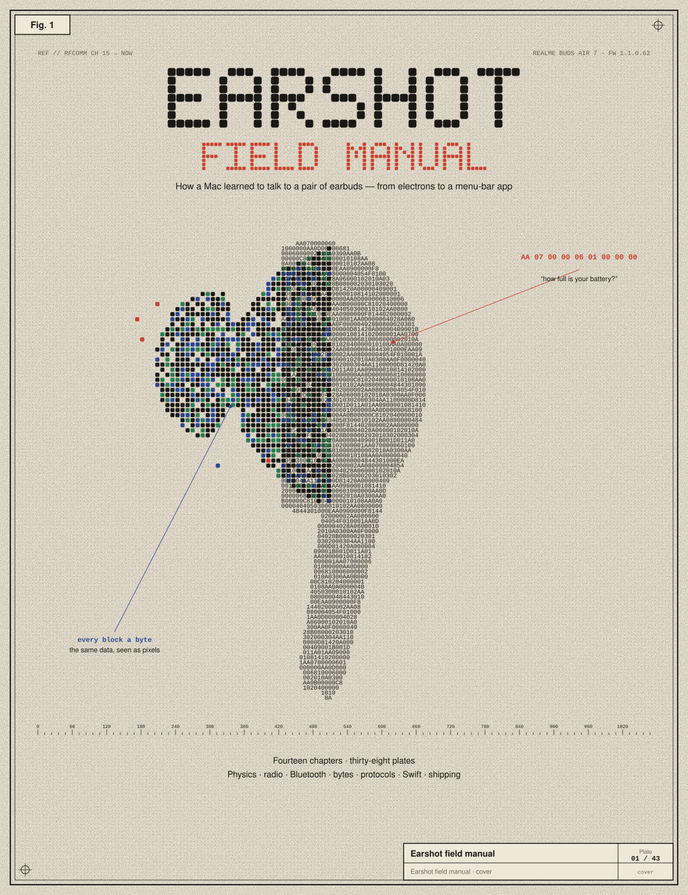
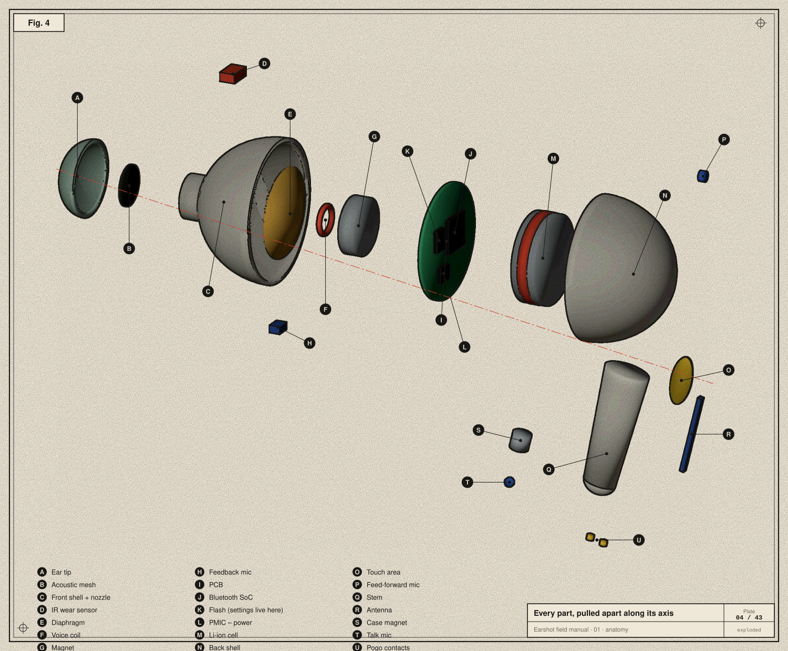

<p align="center"></p>

# Channel Fifteen

*The Earshot field manual. Named for RFCOMM channel 15, the hidden serial door the whole story is about.*

**How a Mac learned to talk to a pair of earbuds — told as a story, explained from first principles.**

[Earshot](https://github.com/srivtx/earshot) is a macOS menu-bar app that shows earbud battery levels and changes noise cancelling, EQ, spatial audio and tap controls — things the earbuds' makers only offer on phones. This manual documents how it was built, from the very bottom: what's inside an earbud, how sound becomes bits, how radio carries them, how Bluetooth layers them, how we found a hidden channel on a realme Buds Air 7 and learned its language byte by byte, how that grew to seven brands, and how the app was designed, tested and shipped.

Every byte in the plates is real — captured from the buds or computed with Earshot's own arithmetic. The earbud was modelled in Blender for this manual, and the website tells the story in 3D with that model.

**Website: [srivtx.github.io/channel-fifteen](https://srivtx.github.io/channel-fifteen/)** — the same chapters as a scroll-driven 3D story: the Blender earbud pulled apart part by part, then docked in its case as the lid shuts, plus a live packet decoder and an animated hopping grid. Source in [`site/`](site/).

## Contents

| | Chapter | You'll learn |
|---|---|---|
| 00 | [Prologue](chapters/00-prologue.md) | the whole story, step by step |
| 01 | [Anatomy of an earbud](chapters/01-anatomy-of-an-earbud.md) | every part, what it does, where settings live, how ANC works |
| 02 | [Sound to signals to bits](chapters/02-signals-to-bits.md) | sampling, voltages, bytes, hex, endianness, bit masks, LEB128 |
| 03 | [Radio](chapters/03-radio.md) | EM waves, 2.4 GHz, GFSK, frequency hopping, piconets, TWS |
| 04 | [The Bluetooth stack](chapters/04-the-bluetooth-stack.md) | HCI, L2CAP, SDP, RFCOMM, profiles, codecs — and why a Mac can't change settings |
| 05 | [Finding the door on macOS](chapters/05-finding-the-door-on-macos.md) | IOBluetooth, SDP records, permissions, retries |
| 06 | [The method](chapters/06-reverse-engineering-method.md) | prior art, read-only probing, the watcher, change-read-revert, test vectors |
| 07 | [OPO byte by byte](chapters/07-opo-byte-by-byte.md) | the realme / OPPO / OnePlus protocol, every field and command |
| 08 | [Integrity](chapters/08-integrity.md) | framing, escaping, checksums, CRCs, stream reassembly, ACKs |
| 09 | [The other brands](chapters/09-the-other-brands.md) | Samsung, Sony, Nothing, soundcore, and one Driver interface |
| 10 | [The app](chapters/10-the-app.md) | architecture, link states, the queue, optimistic UI, design, the journal |
| 11 | [Shipping](chapters/11-shipping.md) | SwiftPM, tests, bundling, signing, releases, CI |
| 12 | [Glossary and credits](chapters/12-glossary-and-credits.md) | every term, and who made this possible |

<p align="center"></p>

## Rebuilding everything

```bash
# 1. The 3D model and renders — in Blender 5.x (Scripting tab, or through the Blender MCP add-on):
#    exec(open("tools/earbud_blender.py").read())    → renders/assembled.png, exploded.png, case.png
#    exec(open("tools/parts_blender.py").read())     → renders/parts/*.png
#    exec(open("tools/export_gltf.py").read())       → site/public/models/*.glb
# 2. The 43 plates (Python 3 + Pillow):
python3 tools/build_figures.py
zsh tools/preview.sh /tmp/plates figures/*.svg       # optional PNG previews via headless Chrome
# 3. The website (Astro + three.js):
cd site && npm install && npm run dev
```

## Layout

```
chapters/   the manual, one Markdown file per chapter (reads on GitHub, rendered by the site)
figures/    43 SVG plates, generated
renders/    Blender renders used by the plates
tools/      plate kit (plate.py), figure modules (figs_*.py), Blender scripts
site/       Astro website: byte-drawn hero, 3D story, chapters, packet decoder
```

## Credits

Built on the open protocol work of [Gadgetbridge](https://gadgetbridge.org) and [GalaxyBudsClient](https://github.com/timschneeb/GalaxyBudsClient), and the OnePlus Buds write-up by Aasheesh. Made by [srivtx](https://github.com/srivtx) with Claude.
