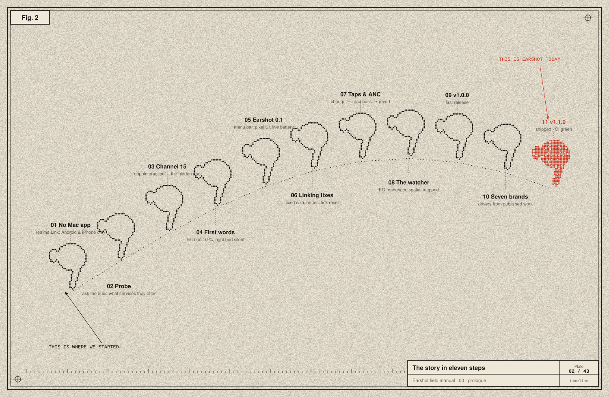

# 00 · Prologue: a pair of earbuds that wouldn't talk to a Mac

## The problem

It started with one sentence: *"I have a realme Buds Air 7. All features are available on Android, but on the Mac they're not. What can we do?"*

On a phone, the **realme Link** app shows each bud's battery. It switches between noise cancelling, transparency and off, and picks how strong the cancelling is. It changes the EQ, turns on spatial audio and a "volume enhancer", and lets you choose what each tap does. On a Mac you get none of that. The buds play music and take calls, but every setting is invisible. realme doesn't make a Mac app.

The first honest answer was "set things up on your phone; most settings are stored on the buds, so they carry over". The reply was: *"Any software thing we can do? I guess we can pull it off."*

This manual is the record of pulling it off. It covers how a Mac learned to speak to a pair of earbuds that were never designed to talk to it. Then it covers how one app, **Earshot**, grew to speak to earbuds from seven brands. We explain everything on the way down: sound, electrons, radio waves, Bluetooth, bytes and protocols. Then everything on the way back up: Swift, SwiftUI, testing, signing and shipping.

## Why the Mac couldn't already do it

Connecting earbuds to a Mac sets up **audio**: music one way, the microphone the other, and play/pause buttons. Settings aren't audio. They're private messages between the companion app and the buds' firmware, sent over a separate, vendor-specific channel. macOS has never heard of that channel and never opens it. [Chapter 04](04-the-bluetooth-stack.md) explains exactly where that line is drawn.

So the question became: *can a Mac open that channel and speak the buds' language?*

## The story, step by step

**1 · No Mac app.** realme Link exists only for Android and iPhone.

**2 · Probe.** The first idea was Bluetooth Low Energy (BLE). Many buds expose their settings over BLE GATT services. realme, OPPO and OnePlus share a parent company, BBK Electronics, and share a control protocol. Someone had already reverse-engineered it for OnePlus Buds, and the open-source Android app **Gadgetbridge** already supported some realme buds. A small Swift program, `probe.swift`, was written to list every service the buds offer. macOS wouldn't let it touch Bluetooth from inside the assistant's sandbox: the system's privacy layer (TCC) shut it down. So it was run from Terminal.app, which could ask for Bluetooth permission.

**3 · Channel 15.** The buds' service list included an entry named **`oppointeraction`** with a 128-bit UUID starting `0000079A`. It isn't a BLE service: it's classic Bluetooth **RFCOMM, channel 15**. That was the door.

**4 · First words.** A second test program, `rfcomm.swift`, opened channel 15 and sent the battery question from Gadgetbridge's OPPO code. The buds answered:

| Asked | The buds said |
|---|---|
| Left bud | 10 % battery |
| Right bud | *(no answer: it was flat)* |
| Case | 0, i.e. unreadable because the buds were out |
| Noise control | ANC on |
| Firmware | 1.1.0.62 on both buds |

That matched reality exactly: left bud low, right bud dead. The Mac was reading real values from the buds. One quirk showed up immediately: the channel often refused the *first* open after the buds connected, and accepted the second.

**5 · Earshot 0.1.** Next came a real app, a menu-bar popover in the user's design language. It used oauth-ready's pink, ink and grain-green palette, pixel-art sprites drawn from bitmaps, a briefing-sheet grid and a procedural grain texture. It showed live battery for each bud and the case, in-ear status, and Off / Ambient / ANC switching. It also had game mode, dual-device, find-my-buds and launch at login.

**6 · Linking fixes.** Two bugs appeared in real use.
- **Stuck on "linking"** while the buds were plainly connected. The app was holding an outdated `IOBluetoothDevice` object, and a force-quit copy had left the channel half-open, so the buds refused newcomers. The fixes:
  - always fetch the current device object;
  - retry with growing delays;
  - reset the Bluetooth link if retries keep failing;
  - close the channel cleanly on quit, even on SIGTERM.
- **Flicker:** the popover resized when its content changed, and macOS redrew it at the wrong size for a frame. The fix was a fixed size. Controls never move; they dim until linked.

After the fixes, three kill-and-reopen cycles linked in about 0.15 s each.

**7 · Taps and ANC strength.** The user asked for everything realme Link has: EQ, "LHDC 5.0" Hi-Res audio, volume enhancer, spatial audio, and button customisation, *"but don't make our visuals cluttered"*. The popover grew three tabs (Buds, Sound, Taps) at the same fixed size.
- Tap controls and ANC strength were documented in Gadgetbridge. They were still tested on the real buds by **changing one thing, reading everything back, and reverting**.
- That loop caught a real bug before it shipped: the first touch encoder had two bytes in the wrong order and would have changed the wrong gesture. [Chapter 06](06-reverse-engineering-method.md) tells that story.

**8 · The watcher.** EQ, volume enhancer and spatial audio weren't documented anywhere for realme. The buds reported 14 unlabelled settings. Guessing could flip the wrong one, so we watched instead:
- With dual-device on, the phone and the Mac were connected at the same time.
- A read-only program on the Mac polled every setting while the user changed one feature at a time on the phone.
- The user reported the order: *enhancer was on → off → on; spatial off → on → off; EQ Deep bass → Serenade → Original → Clear bass → Deep bass*.

Every change on the phone appeared as exactly one changed value on the Mac.

**9 · v1.0.0.** The user disliked the notification toasts (*"so unneeded, horrible"*), so errors moved to the header subtitle. Flicker on opening was fixed, README screenshots were rendered live from the app, and **Earshot v1.0.0** was released on GitHub, followed by v1.0.1.

**10 · Seven brands.** Then: *"Most earbuds that are not Apple — OPPO, realme, Samsung — and all the earphones sold in India and English-speaking countries. I don't have them. Is that doable?"*

It is doable, carefully. Published, open protocol work already existed for Samsung (GalaxyBudsClient, Gadgetbridge), Sony, Nothing and Anker soundcore (Gadgetbridge), including messages captured from real devices.
- Earshot was rebuilt around a brand-neutral model and one **driver** per protocol family.
- Every driver's parser was tested against those captured messages.
- Every brand except the one we own is labelled **beta**.
- A **Report** button lets owners send a byte-level log, so each one can be confirmed.

**11 · v1.1.0.** Shipped, with CI green.

## How to read this manual

Each chapter starts from first principles and ends at Earshot's actual code. You can read straight through, or jump in:

- To understand **the hardware**, start at [01 · Anatomy](01-anatomy-of-an-earbud.md).
- To understand **bits and bytes** from zero, read [02](02-signals-to-bits.md).
- To understand **wireless**, read [03 · Radio](03-radio.md) and [04 · The Bluetooth stack](04-the-bluetooth-stack.md).
- To **build your own** device-talking tool, read [05](05-finding-the-door-on-macos.md), [06](06-reverse-engineering-method.md), [07](07-opo-byte-by-byte.md) and [08](08-integrity.md).
- To understand **Earshot's code**, read [09](09-the-other-brands.md), [10](10-the-app.md) and [11](11-shipping.md).
- Unfamiliar word? [12 · Glossary](12-glossary-and-credits.md).

Every byte drawn in the plates is real: either captured from the realme Buds Air 7 (and kept as test vectors in Earshot's `ProtocolTests.swift`) or computed with the same arithmetic as Earshot's drivers. Where a value is only illustrative, such as Bluetooth connection handles that change on every connection, the plate says so.

Next: [01 · Anatomy of an earbud →](01-anatomy-of-an-earbud.md)
