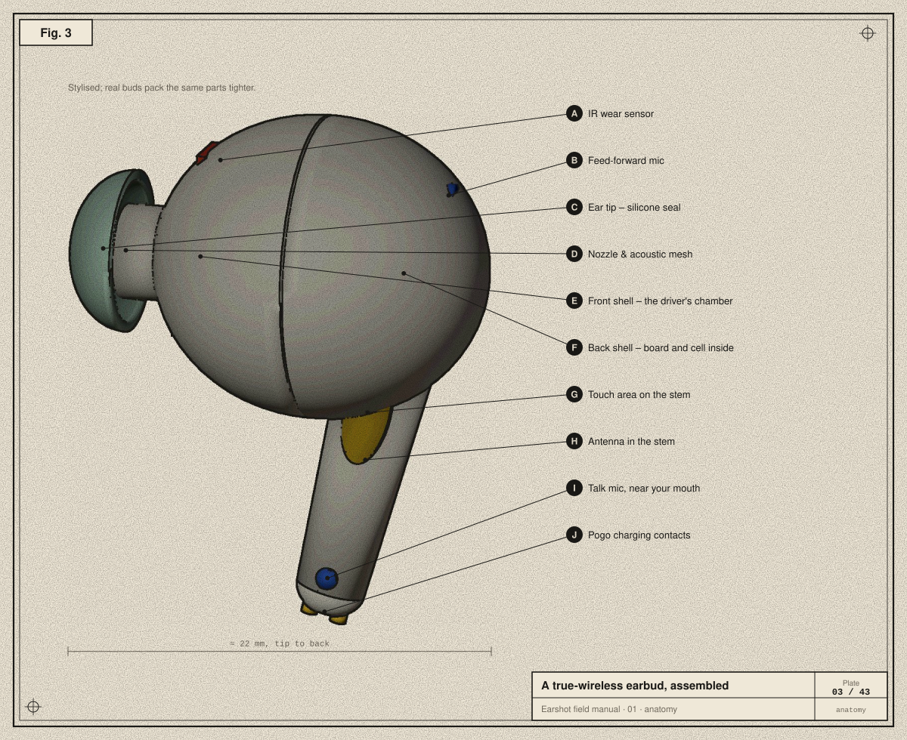
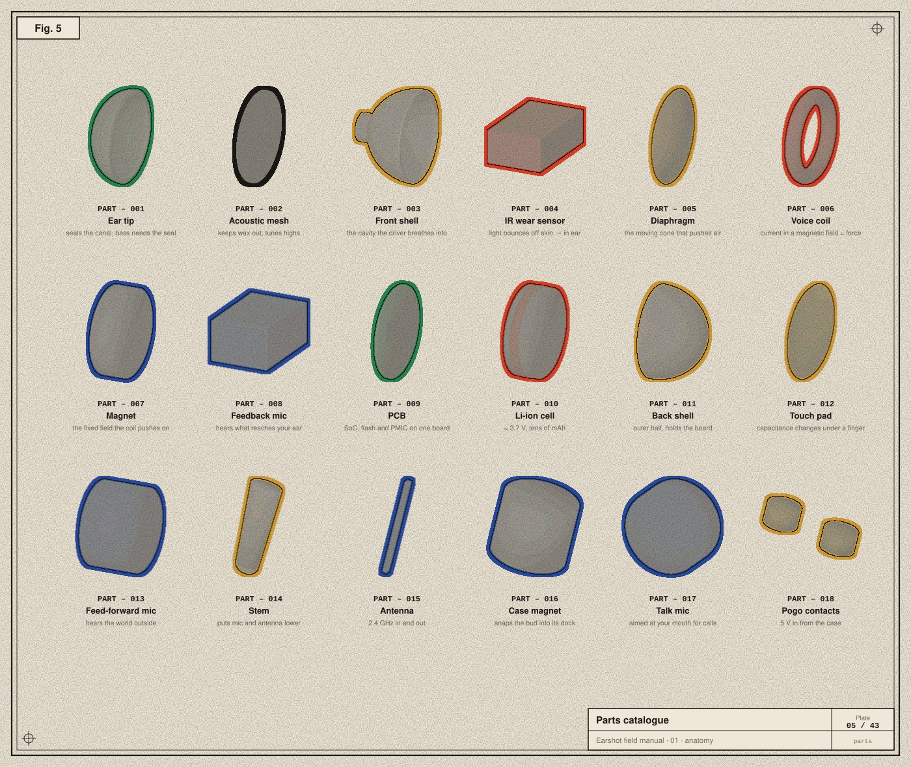
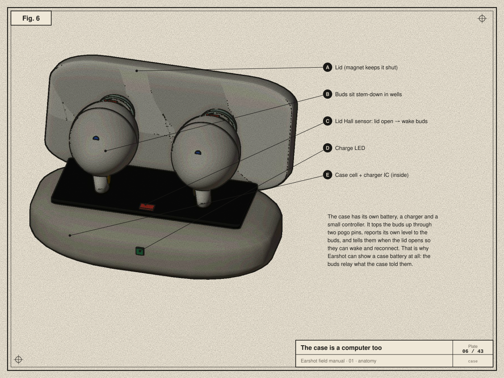
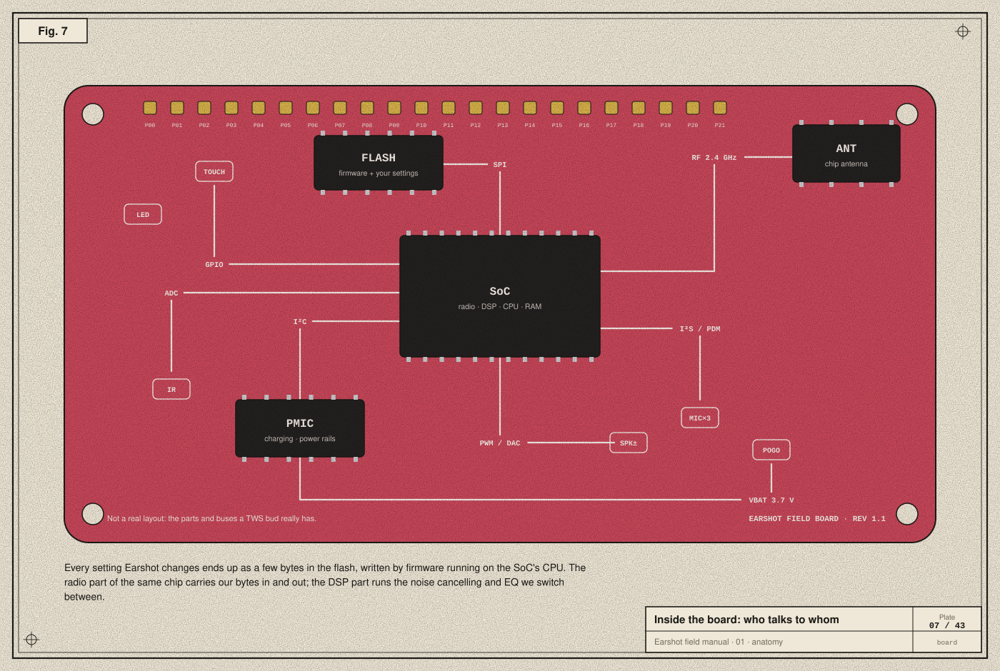
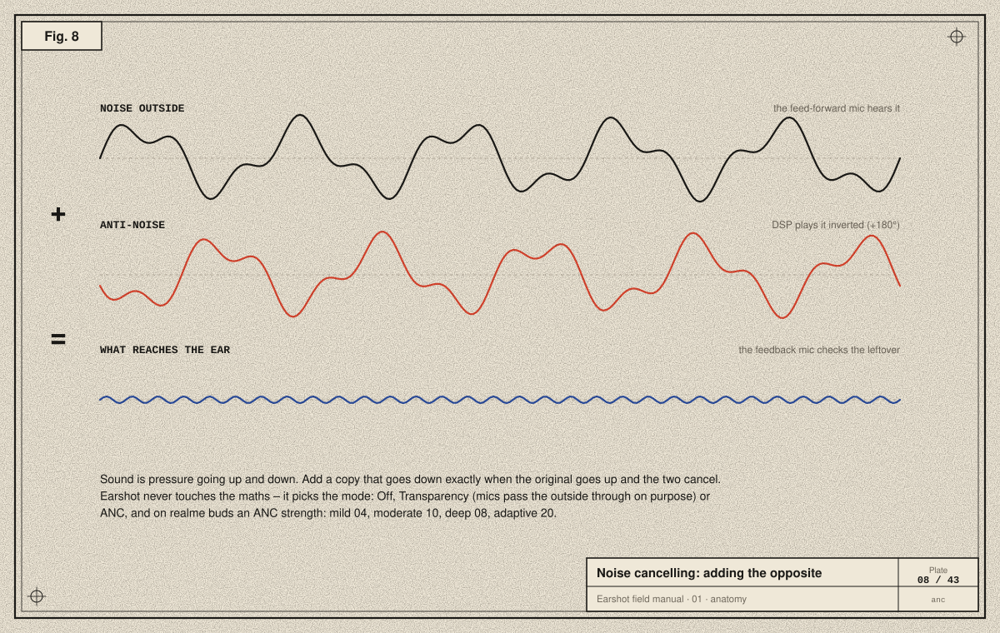

# 01 · Anatomy of an earbud

> **In the story:** before the first byte, we had to know what we were talking to. A Mac sees "a pair of headphones"; inside each bud is a computer with sensors, a radio and memory where every setting lives.

Before we send a single byte, we should know what we're talking to. A true-wireless (TWS) earbud is a complete computer, with a battery, a radio, a processor, memory, sensors, microphones and a speaker, small enough to sit in your ear canal. Every setting Earshot changes ends up somewhere in this small machine.

The model in these plates was built in Blender for this manual (`tools/earbud_blender.py`). It is stylised, but every part is one a real stem-style bud has.

## Pulled apart

Going from the ear outwards:

| Part | What it is | What it does |
|---|---|---|
| **Ear tip** | soft silicone dome | Seals the ear canal. Without the seal, bass leaks out and noise cancelling has nothing to work with. |
| **Acoustic mesh** | a fine screen in the nozzle | Keeps ear wax out and damps harsh high frequencies. |
| **Front shell + nozzle** | the half facing your ear | Forms the small air chamber in front of the speaker. |
| **IR wear sensor** | a tiny infrared LED + photodiode | Light bounces off skin when the bud is in your ear. That's how the buds know to pause music when you take one out, and why they report "in ear / out / in case". |
| **Diaphragm** | a thin, light cone | The part that actually moves air and makes sound. |
| **Voice coil** | a coil of very fine wire glued to the diaphragm | Current through it makes a magnetic field. |
| **Magnet** | a permanent magnet | Its field and the coil's field push and pull, so the coil (and diaphragm) moves with the signal. Together these three parts are the **dynamic driver**, the speaker. |
| **Feedback mic** | a microphone *inside*, facing the ear | Hears what actually reaches your eardrum; used to correct noise cancelling. |
| **PCB** | printed circuit board | Holds and wires together the chips below. |
| **Bluetooth SoC** | system-on-chip | Radio, DSP (audio maths), CPU and RAM on one die. Runs the firmware. |
| **Flash** | non-volatile memory | Stores the firmware **and your settings**. When Earshot changes your EQ, it ends up here, which is why it survives switching to your phone. |
| **PMIC** | power-management IC | Charges the cell, and makes the clean voltages the other chips need. |
| **Li-ion cell** | a tiny rechargeable battery | Typically ≈ 3.7 V and a few tens of mAh. Its level is what Earshot shows. |
| **Back shell** | the outer half | Holds the board and cell. |
| **Touch area** | a copper pad behind the plastic | Your finger changes its capacitance. The firmware counts taps and holds; *what each one does* is a setting Earshot can change. |
| **Feed-forward mic** | a microphone *outside* | Hears the world before it reaches you; the main input for noise cancelling and transparency. |
| **Stem** | the "stick" | Puts the talk mic closer to your mouth and the antenna away from your head. |
| **Antenna** | a thin conductor tuned to 2.4 GHz | Where the radio waves leave and arrive. |
| **Case magnet** | a small magnet | Snaps the bud into its dock in the case. |
| **Talk mic** | the call microphone | Aimed at your mouth; several mics are combined to reject wind and noise. |
| **Pogo contacts** | two spring-loaded gold pads | Where the case delivers charging power. |

## The same parts, as a catalogue

## The case is a computer too

The charging case has its own battery, charger chip and a small controller.
- A **Hall-effect sensor** notices the lid magnet. A Hall sensor is a chip whose output voltage changes in a magnetic field. Opening the lid wakes the buds, which is when they reconnect to your phone or Mac.
- The case reports its own battery level to the buds.
- The buds relay that level to whatever is connected, which is why Earshot can show a case battery at all.
- When the lid is shut and the buds are inside, the case often can't be read. Earshot treats a case level of `0` with no charging flag as "unknown", not "empty" (see [chapter 07](07-opo-byte-by-byte.md)).

## Who talks to whom inside

The SoC is the centre of everything. It connects to the other parts through a handful of standard on-board buses:

- **SPI** (Serial Peripheral Interface): a fast clocked bus to the **flash** chip. Firmware and settings are read and written over it.
- **I²C** (Inter-Integrated Circuit): a slow two-wire bus for configuration chips like the **PMIC** and sensors.
- **I²S / PDM**: digital audio buses. Digital mics usually send *PDM*, a fast stream of single bits whose density encodes the sound. The SoC turns that into ordinary samples.
- **DAC → amplifier → speaker**: numbers become a voltage that drives the voice coil.
- **GPIO / ADC**: general-purpose pins and analog-to-digital converters for the touch pad, IR sensor and LED.
- **RF**: the radio front end and antenna.

You never see these buses, and Earshot never touches them. The firmware does. What Earshot sends is a request like "set ANC to deep", in the firmware's own language, over Bluetooth. The firmware then writes the flash and reconfigures the DSP itself. That separation is why talking to earbuds is safe: we can only ask for things the firmware already knows how to do.

## How noise cancelling works

Sound is a pressure wave: tiny fast rises and falls in air pressure ([chapter 02](02-signals-to-bits.md)). If you add a second wave that falls exactly when the first rises, the two cancel. **Active noise cancelling (ANC)** works like this:

1. The **feed-forward mic** hears outside noise *before* it reaches you.
2. The DSP computes the inverted wave (180° out of phase), predicting how the noise will change on its way through the shell, and plays it through the speaker *along with* your music.
3. The **feedback mic** inside measures what is left and corrects the filter continuously.

Noise cancelling works best on steady low sounds (engines, fans) and worst on sudden high ones (voices, clatter). Those are blocked mostly by the ear tip's physical seal.

**Transparency** ("Ambient" in Earshot) does the opposite on purpose: it plays the outside world *through* the mics so you can hear it. **Off** turns both processes off.

realme buds expose four ANC strengths, which are simply different filters:

| Strength | Code on the wire |
|---|---|
| mild | `04` |
| moderate (shown as "mid") | `10` |
| deep | `08` |
| adaptive (buds pick by listening) | `20` |

The codes aren't in order of strength, a reminder that protocol codes are labels, not numbers to compare.

## What this means for software

Everything Earshot shows or changes maps onto these parts:

| Earshot shows | Comes from |
|---|---|
| Battery per bud and case | PMIC fuel gauge → firmware → Bluetooth |
| IN EAR / OUT / CASE | IR wear sensor and pogo-pin power |
| Off / Ambient / ANC and strength | DSP filter selection, stored in flash |
| EQ presets | DSP filter coefficients |
| Spatial audio, bass, wind reduction | DSP effects |
| Tap actions | firmware's touch event table, stored in flash |
| Find my buds | firmware plays a loud tone through the driver |
| Hi-Res (LHDC) | which codecs the radio offers a phone ([chapter 04](04-the-bluetooth-stack.md)) |

Next: [02 · Sound to signals to bits →](02-signals-to-bits.md)
