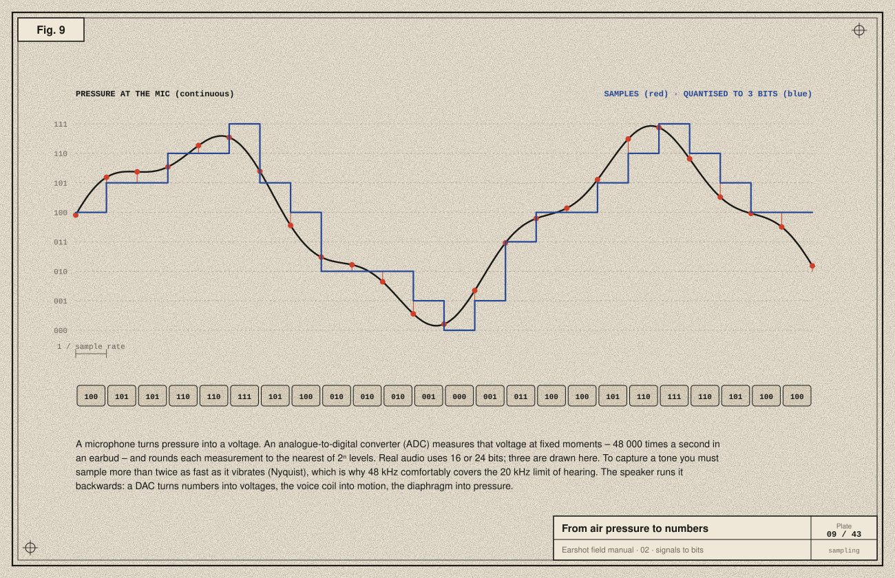
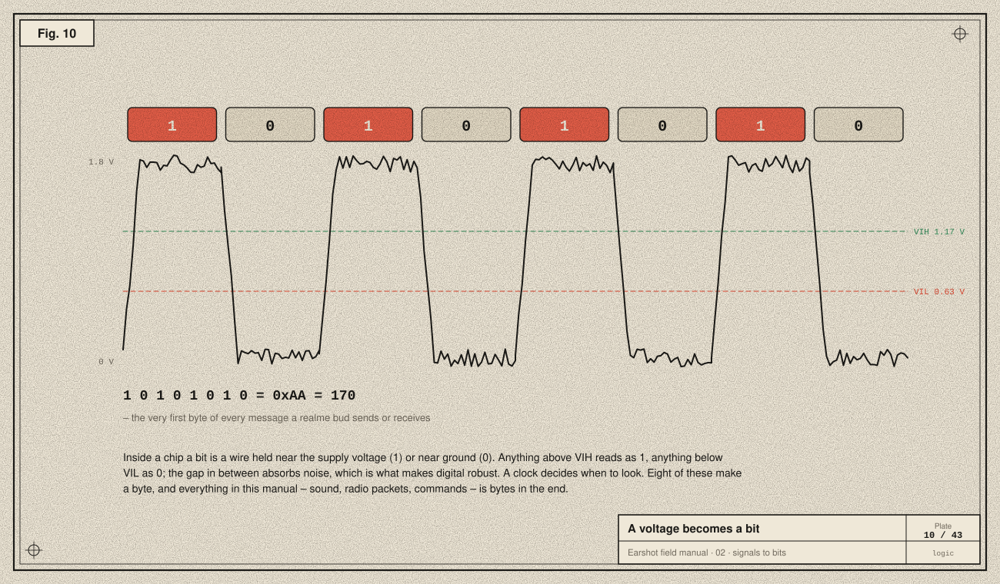
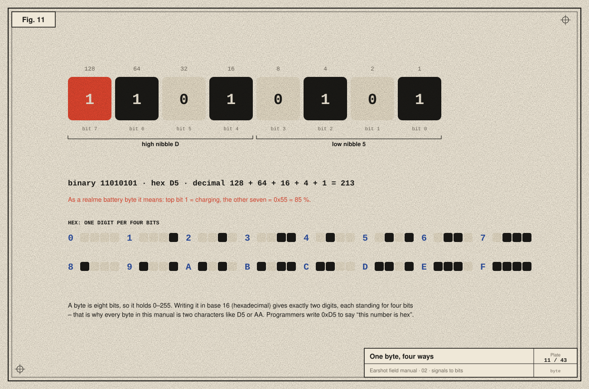
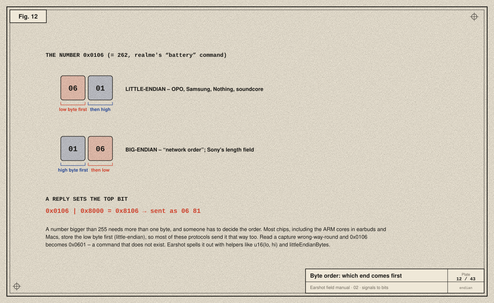
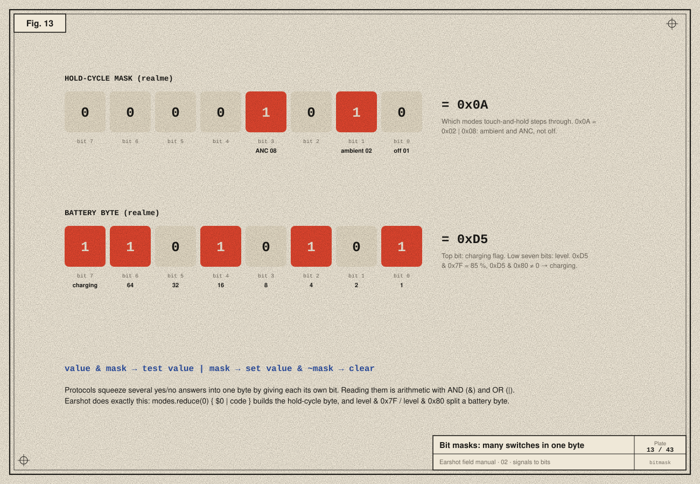
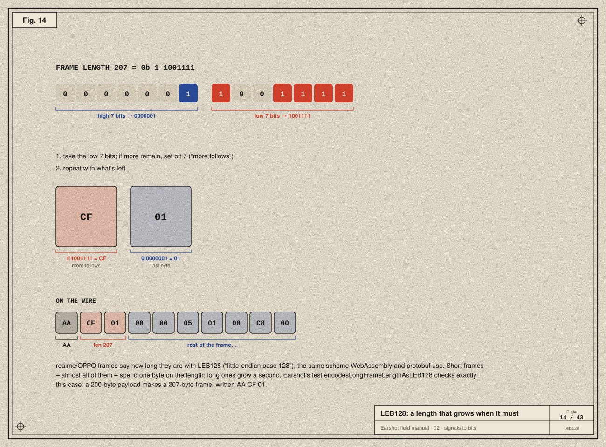

# 02 · Sound to signals to bits

> **In the story:** the first reply from the buds was a row of numbers like `AA 0D 00 00 06 81 …`. To read it we need to know what a byte is, why it's written in hex, and why `06 81` means 0x8106. This chapter builds that from air pressure upwards.

Everything Earshot does is moving numbers around. Before we can read a protocol, we need to know what a number *is* inside a machine, starting from the air in your ear.

## Sound is pressure

Sound is air molecules being pushed together and pulled apart, very quickly. A speaker cone moves back and forth, and that creates regions of slightly higher and slightly lower pressure that travel outwards at about 343 m/s.
- How *often* the pressure swings per second is the **frequency**, measured in hertz (Hz). We hear roughly 20 Hz to 20 000 Hz.
- How *far* it swings is the **amplitude**, heard as loudness.

A microphone has a thin membrane that moves with those pressure changes, and the movement is turned into a tiny voltage that rises and falls in step. That voltage is an **analogue** signal: a continuous copy of the sound.

## Sampling and quantising



A computer can't store "a continuous voltage", only numbers. An **analogue-to-digital converter (ADC)** does two things:

1. **Sampling:** it measures the voltage at fixed intervals, typically 48 000 times per second (48 kHz) in earbuds. The **Nyquist theorem** says that to capture a frequency you must sample more than twice as fast as it, so 48 kHz covers everything up to 24 kHz, beyond human hearing.
2. **Quantising:** it rounds each measurement to the nearest of a fixed set of levels. *n* bits give 2ⁿ levels: 3 bits give 8 (as drawn), 16 bits give 65 536, and 24 bits over 16 million. The rounding error is *quantisation noise*; more bits make it quieter.

Going back out, a **digital-to-analogue converter (DAC)** turns numbers into a voltage, an amplifier strengthens it, and the voice coil turns it into motion ([chapter 01](01-anatomy-of-an-earbud.md)).

Uncompressed CD-quality stereo is 44 100 samples × 16 bits × 2 channels ≈ 1.4 Mbit/s. That's far more than Bluetooth carries reliably, which is why audio is **compressed** by a *codec* before it is sent ([chapter 04](04-the-bluetooth-stack.md)).

## A voltage becomes a bit



Inside digital chips a wire is either near the supply voltage or near 0 V.
- In a modern low-power chip the supply might be 1.8 V.
- The chip promises to read anything above **V<sub>IH</sub>** (about 65 % of supply) as **1**, and anything below **V<sub>IL</sub>** (about 35 %) as **0**.
- The gap between them is a safety margin: noise can't flip a bit. That margin is why digital electronics are reliable.

A **clock** decides *when* to look at the wire. One look, one **bit** (*binary digit*).

The waveform in the plate is `1 0 1 0 1 0 1 0`, the byte `0xAA`. It's the first byte of every message a realme bud sends or receives.

## The byte



Eight bits make a **byte**. Each position is worth a power of two, from 128 down to 1. Add the positions holding a 1 and you get its value, 0 to 255.

Eight binary digits are tedious to write, so we use **hexadecimal** (base 16): 0–9 then A–F (A = 10 … F = 15). One hex digit is exactly four bits, so a byte is always exactly two hex digits.

```
binary  1101 0101
hex       D    5     → 0xD5
decimal 128 + 64 + 16 + 4 + 1 = 213
```

The `0x` prefix means "this is hex". In this manual every byte is written as two hex digits: `AA`, `0D`, `D5`.

> **Try it:** `python3 -c "print(0xD5, bin(0xD5), hex(213))"`

## Numbers bigger than a byte: endianness



The realme "battery" command is the 16-bit number `0x0106`. On the wire it must become two bytes, in some order:

- **Little-endian:** low byte first, `06 01`. ARM and Intel processors work this way, and so do OPO, Samsung, Nothing and soundcore.
- **Big-endian:** high byte first, `01 06`. This is the classic "network order", used by Sony's 32-bit length field.

Read it the wrong way round and `0x0106` (battery) becomes `0x0601`, a command that doesn't exist. Earshot keeps the rule in two helpers (`EarshotCore/Checksums.swift`):

```swift
extension UInt16 {
    var littleEndianBytes: [UInt8] { [UInt8(self & 0xFF), UInt8(self >> 8)] }
}
func u16(_ lo: UInt8, _ hi: UInt8) -> UInt16 { UInt16(lo) | UInt16(hi) << 8 }
```

OPO marks a **reply** by setting the command's top bit: `0x0106 | 0x8000 = 0x8106`, sent as `06 81`. A `81` in a frame's sixth byte means "this is an answer".

## Many switches in one byte: bit masks



**The hold-cycle mask.** "Touch and hold" switches between noise modes, and you choose which. Each mode has its own bit: off `0x01`, transparency `0x02`, ANC `0x08`. Combine with OR:

```
0x02 | 0x08 = 0x0A   → hold cycles between transparency and ANC
```

Earshot builds the byte in one line: `modes.reduce(0) { $0 | OPOCode.mode($1) }`.

**The battery byte.** The top bit means *charging*, and the low seven bits are the level:

```
0xD5 & 0x80 = 0x80  → charging
0xD5 & 0x7F = 0x55  → 85 %
```

| Operation | Example | Effect |
|---|---|---|
| `value & mask` | `0xD5 & 0x80` | test a bit |
| `value \| mask` | `0x02 \| 0x08` | set a bit |
| `value & ~mask` | `0x0A & ~0x02` | clear a bit (`~` flips all bits) |

## A length that grows: LEB128



Every message must say how long it is ([chapter 08](08-integrity.md)). A one-byte length caps messages at 255 bytes; a four-byte length wastes three bytes on every small message. realme/OPPO frames use **LEB128** (little-endian base 128), a variable-length scheme also used by WebAssembly and protocol buffers:

1. Take the lowest 7 bits.
2. If anything is left, set the top bit ("more follows"), write the byte, shift right by 7, and repeat.
3. The last byte has its top bit clear.

So 13 is `0D`, and 207 is `CF 01`. Earshot's encoder:

```swift
static func encode(_ value: UInt) -> [UInt8] {
    var v = value
    var out: [UInt8] = []
    repeat {
        var byte = UInt8(v & 0x7F)
        v >>= 7
        if v != 0 { byte |= 0x80 }
        out.append(byte)
    } while v != 0
    return out
}
```

The test `encodesLongFrameLengthAsLEB128` builds a frame with a 200-byte payload (frame length 207) and checks that it starts `AA CF 01`.

## Take-aways

- Sound → voltage → samples → numbers, and back again.
- A bit is a voltage judged against a threshold. A byte is eight bits, and hex writes it as two digits.
- Multi-byte numbers have an order. Endianness mistakes are the most common protocol bug.
- Single bits can mean separate things (masks), and lengths can be encoded compactly (LEB128).

Next: [03 · Radio →](03-radio.md)
