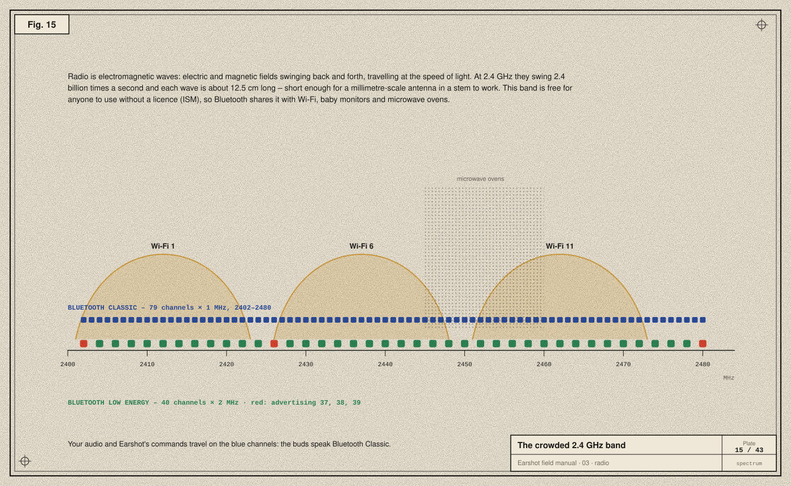
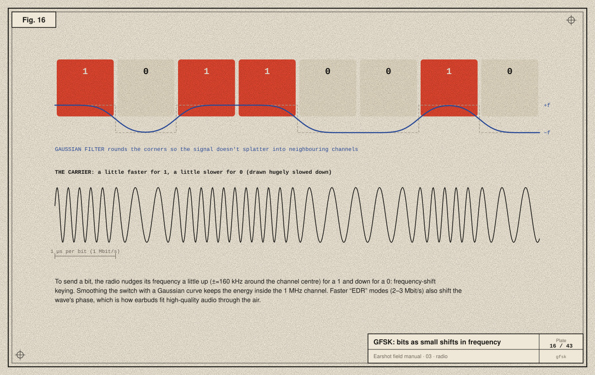
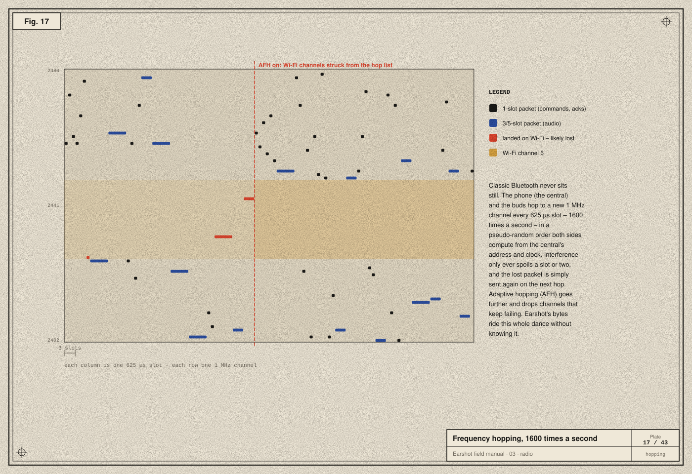
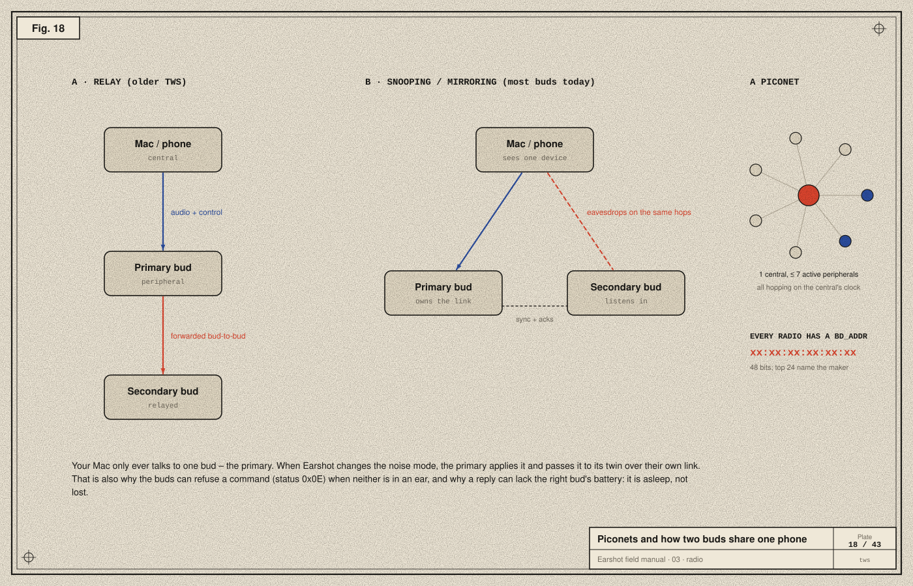

# 03 · Radio

> **In the story:** the bytes we write on the Mac arrive in the buds a few centimetres away, through the air, past Wi-Fi and microwaves. This is how.

Between the Mac and the buds there is no wire, only air. This chapter is about how bytes cross that gap.

## Electromagnetic waves

When electric charge moves back and forth in a conductor (an **antenna**), it creates electric and magnetic fields that also swing back and forth. Those changing fields regenerate each other and travel away at the speed of light: an **electromagnetic wave**. Radio, Wi-Fi, light and X-rays are all the same thing at different frequencies.

**Wavelength = speed of light ÷ frequency.** At 2.4 GHz (2.4 billion swings per second):

```
λ = 300 000 000 m/s ÷ 2 400 000 000 Hz ≈ 0.125 m = 12.5 cm
```

An efficient simple antenna is about a quarter wavelength (≈ 3 cm), and clever shapes fold that into a few millimetres of metal in an earbud's stem. Another antenna, in the Mac, turns the passing wave back into a tiny current.

## The 2.4 GHz band



2400–2483.5 MHz is an **ISM** band (industrial, scientific, medical). Anyone may transmit there at low power without a licence, which is why it's crowded with Wi-Fi, Bluetooth, baby monitors, wireless mice and microwave ovens leaking around 2450 MHz.

Bluetooth divides it two ways:
- **Bluetooth Classic (BR/EDR):** 79 channels, each 1 MHz wide, from 2402 to 2480 MHz. Music, calls and Earshot's control channel all use Classic.
- **Bluetooth Low Energy (BLE):** 40 channels, each 2 MHz wide. Three of them (37, 38, 39, placed between the busiest Wi-Fi channels) are for *advertising*, the "I'm here" beacons devices use to be found. Many newer buds also speak BLE, and LE Audio is the next generation of Bluetooth audio, but the buds in this manual are controlled over Classic.

## Putting bits on a wave: GFSK



A plain wave at one frequency carries no information. To send bits you must change something about it: **modulation**. Bluetooth Classic's basic rate uses **Gaussian frequency-shift keying (GFSK)**:

- For a **1**, nudge the frequency slightly above the channel centre (about +160 kHz).
- For a **0**, nudge it slightly below.
- Smooth each switch with a **Gaussian filter** so the signal doesn't spray energy into the neighbouring channels.

At 1 million symbols per second, that's 1 Mbit/s. The **Enhanced Data Rate (EDR)** modes also shift the wave's *phase* (π/4-DQPSK and 8DPSK) to carry 2 or 3 bits per symbol, reaching 2–3 Mbit/s. That headroom is what lets high-quality codecs fit.

## Never sitting still: frequency hopping



With so many neighbours, any one channel will be noisy sometimes. Bluetooth Classic's answer is to **hop**:

- Time is cut into **slots of 625 µs**, and a device may change channel at every slot: **1600 hops per second**.
- The hop order is pseudo-random. Both sides compute it from the *central's* address and clock, so they always land on the same channel at the same time.
- A packet occupies 1, 3 or 5 slots. Short commands (like Earshot's) take one; audio uses longer packets.
- If a slot is spoiled by interference, that packet is not acknowledged, and it's sent again on the next hop.
- **Adaptive frequency hopping (AFH)** goes further: channels that keep failing (say, the ones under a busy Wi-Fi network) are removed from the hop list.

All of this happens inside the Bluetooth chip. By the time Earshot's bytes reach the buds' firmware, they have been chopped into packets, hopped across dozens of channels, retried, reassembled and checked. Earshot never sees any of it, which is exactly the point of layers ([chapter 04](04-the-bluetooth-stack.md)).

## Who's in charge: piconets and addresses



A Bluetooth Classic network is a **piconet**: one **central** (formerly "master"), whose clock and address set the hop pattern, and up to seven active **peripherals**.

Every radio has a 48-bit **BD_ADDR** (Bluetooth device address), written like `xx:xx:xx:xx:xx:xx`. The first half identifies the manufacturer. IOBluetooth uses it to tell devices apart. Earshot compares `addressString` to make sure it's still talking to the same buds, and keeps it out of the reports it saves.

## Two buds, one phone

True-wireless buds have a puzzle: your Mac connects to *one* device, but there are *two* buds. There are two common designs:

- **Relay:** the phone talks to a primary bud, which forwards audio to the secondary over its own bud-to-bud link. Simple, but it costs the primary more battery.
- **Snooping (mirroring):** the primary owns the link, but the secondary listens in on the same hops and receives the same packets, acknowledging through the primary. Most modern buds do this, often with a proprietary variant.

Either way, your Mac's control channel goes to **the primary**. When Earshot says "ANC on", the primary applies it and tells its twin. That explains two behaviours Earshot handles:
- A battery reply can list only one bud: the other is asleep or flat (it was flat the first time we ever asked).
- The buds can refuse a noise-control change with status `0x0E` when neither bud is in an ear.

## Take-aways

- Radio is oscillating fields; 2.4 GHz waves are 12.5 cm long and travel at light speed.
- Bits ride on tiny frequency (and phase) shifts.
- Bluetooth Classic hops across 79 channels 1600 times a second, avoiding bad ones.
- A piconet has one central; TWS buds share one link between two ears.

Next: [04 · The Bluetooth stack →](04-the-bluetooth-stack.md)
