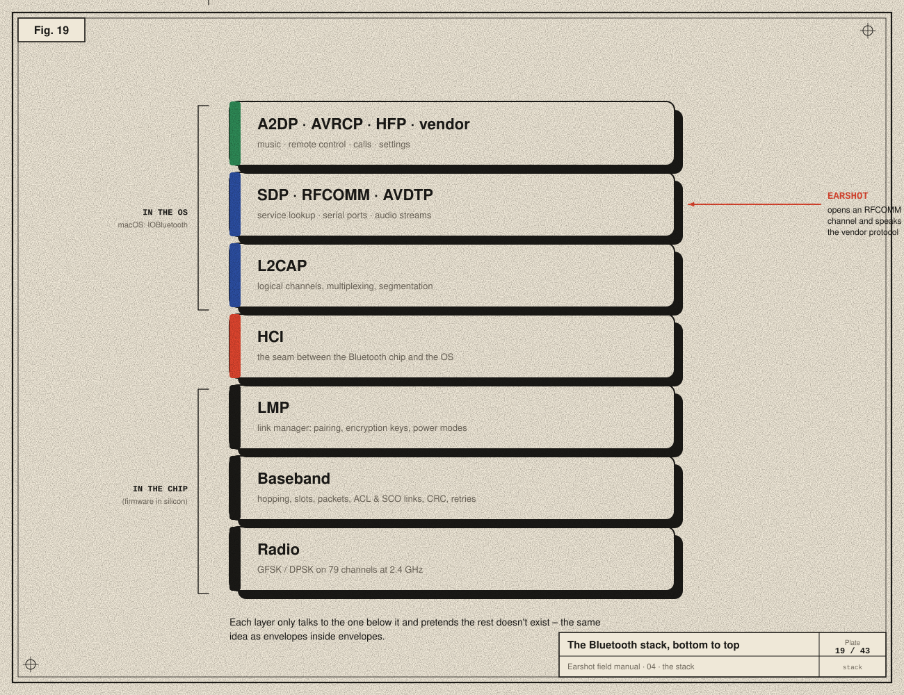
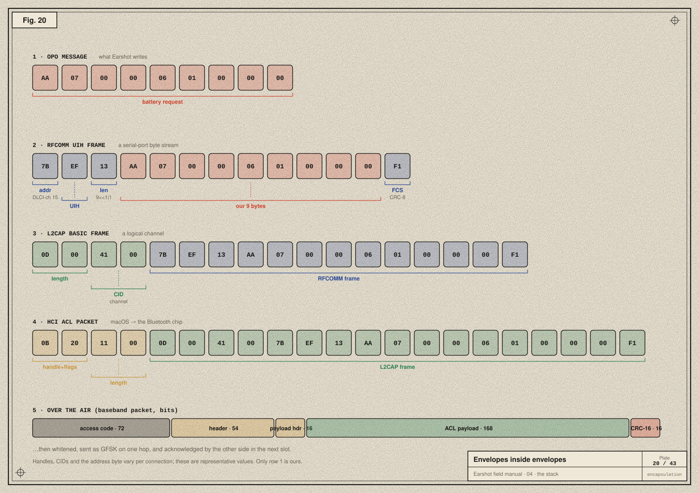
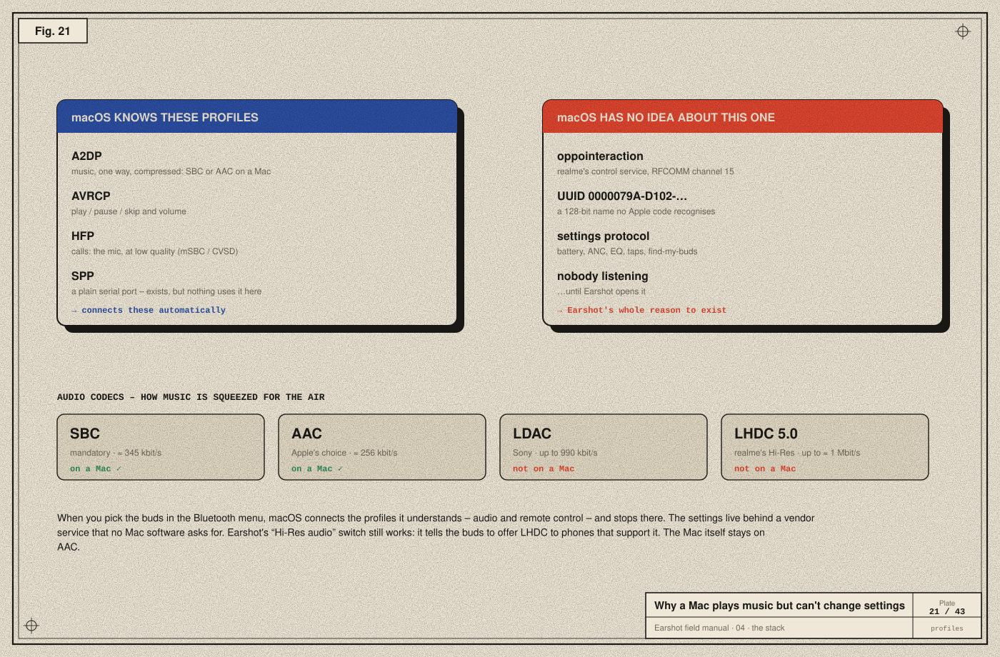

# 04 · The Bluetooth stack

> **In the story:** the buds were already "connected" to the Mac and playing music, yet none of the settings were reachable. The reason is in the layers of the Bluetooth stack, and in which of them macOS chooses to open.

Radio gets bits across the air. But "bits across the air" is a long way from "set ANC to deep". In between sit several layers, each solving one problem and hiding it from the layers above. Together they're called a **stack**.



## In the chip: the controller

The bottom three layers live in the Bluetooth chip itself, as firmware burned into silicon.

- **Radio (PHY):** the physical layer: GFSK/DPSK modulation on 79 channels ([chapter 03](03-radio.md)).
- **Baseband / link controller:** slots, hopping, packet formats, error detection and automatic retransmission. It manages two kinds of logical link:
  - **ACL** (asynchronous connection-less) for data: our commands, and A2DP music, travel on ACL.
  - **SCO/eSCO** (synchronous) for real-time voice in calls.
- **LMP, link manager protocol:** the two chips negotiating. Pairing, encryption keys, power-saving modes, which packet types to use.

## The seam: HCI

The **Host Controller Interface (HCI)** is a standard command and data format between the Bluetooth chip and the computer's operating system.
- On a Mac, macOS sends HCI commands ("connect to this address") and ACL data packets to the chip, and receives events and data back.
- Apple's **PacketLogger** tool (part of Xcode's Additional Tools) records this traffic, which makes HCI the classic place to observe Bluetooth from software.

## In the OS: the host

- **L2CAP, logical link control and adaptation:** many *logical channels* over one ACL link, each identified by a **CID** (channel ID). It also chops big messages into pieces that fit packets, and reassembles them.
- **SDP, service discovery protocol:** the device's table of contents. "Which services do you offer, and how do I reach them?" ([chapter 05](05-finding-the-door-on-macos.md)).
- **RFCOMM:** emulates old RS-232 **serial ports** over L2CAP. A device can offer up to 30 numbered *server channels*, and each behaves like a simple two-way pipe of bytes. **Earshot talks on one of these: channel 15.**
- **AVDTP:** sets up and carries audio streams, used by A2DP.

## Profiles: what the stack is *for*

A **profile** is an agreed use of the stack:

| Profile | What it does |
|---|---|
| **A2DP** (Advanced Audio Distribution) | Stereo music, one way, compressed by a codec. |
| **AVRCP** (A/V Remote Control) | Play, pause, skip, absolute volume. |
| **HFP** (Hands-Free) | Phone calls: microphone and speaker, low bandwidth. |
| **SPP** (Serial Port Profile) | A generic RFCOMM serial link. |

Plus anything a manufacturer invents. realme's control service is a **vendor-specific** RFCOMM service with its own 128-bit UUID.

## Envelopes inside envelopes



Here is the 9-byte message Earshot sends to ask for the battery level, and what each layer wraps around it on its way down:

1. **Our message (OPO):** `AA 07 00 00 06 01 00 00 00`.
2. **RFCOMM UIH frame:**
   - an *address* byte naming the channel (its DLCI is derived from channel 15);
   - a *control* byte (`EF` = UIH, unnumbered information with header check);
   - a *length* (9, written `9 << 1 | 1` because the low bit flags a one-byte length);
   - our bytes;
   - a one-byte **FCS** (frame check sequence, a CRC-8 over the header).
3. **L2CAP basic frame:** a 2-byte length and a 2-byte CID in front.
4. **HCI ACL packet:** a connection *handle* plus flags, and a length.
5. **Over the air:**
   - an access code (derived from the central's address, so other piconets ignore it);
   - a header;
   - the payload;
   - a CRC-16.

The whole packet is then *whitened* (scrambled to avoid long runs of identical bits) and GFSK-modulated on one hop.

The handle, CID and address values differ per connection; the plate shows representative ones. Only the first row is ours. The rest is done by macOS and the chip. When Earshot calls

```swift
channel.writeSync(&bytes, length: UInt16(bytes.count))
```

all of rows 2–5 happen without us.

## Why a Mac plays music but can't change settings



When you click the buds in the Bluetooth menu, macOS:
1. connects the ACL link and encryption,
2. opens **A2DP** for music, **AVRCP** for controls and **HFP** for calls,
3. …and stops.

It has no reason to open realme's vendor service. No Apple code knows what UUID `0000079A-D102-11E1-9B23-00025B00A5A5` means. The settings channel simply sits there unused, and **Earshot is the program that opens it.**

## Codecs, and what "Hi-Res" means on a Mac

Audio over A2DP is compressed by a **codec**, negotiated between the two sides:

| Codec | Who | Typical bitrate | On a Mac? |
|---|---|---|---|
| SBC | mandatory for everyone | ≈ 345 kbit/s max | ✓ |
| AAC | Apple's preference | ≈ 256 kbit/s | ✓ |
| LDAC | Sony | up to 990 kbit/s | ✗ |
| LHDC 5.0 | realme's "Hi-Res" | up to ≈ 1 Mbit/s | ✗ |

Earshot's **Hi-Res audio** switch writes the buds' setting `0x18`. It controls whether the buds *offer* LHDC to devices that support it, such as some Android phones. The Mac itself always negotiates AAC or SBC. The setting is still worth exposing: it's stored on the buds, and it affects your phone.

## Take-aways

- The controller (chip) handles radio, hopping, retries and encryption; the host (OS) handles channels, services and profiles.
- RFCOMM gives us a reliable byte pipe, like a serial cable.
- A Mac connects the audio profiles and nothing else; vendor services are left closed.

Next: [05 · Finding the door on macOS →](05-finding-the-door-on-macos.md)
