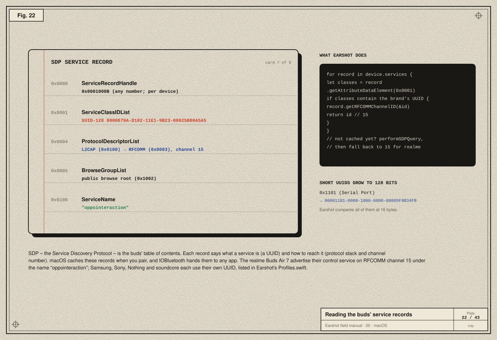
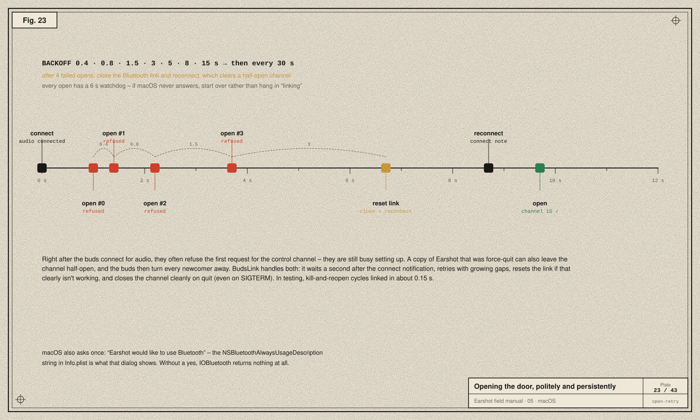

# 05 · Finding the door on macOS

> **In the story:** the probe found the hidden service `oppointeraction` on channel 15, and the first test read the battery. Turning that into an app that links every time took retries, link resets and clean shutdowns, after many rounds of "why does it still say linking?".

We know the buds have a control service on an RFCOMM channel. This chapter is about the practical work of finding it and opening it from a Mac app, and about the ways that goes wrong.

## IOBluetooth

Apple gives Mac apps Bluetooth through two frameworks:
- **CoreBluetooth** for Bluetooth Low Energy (BLE). It also exists on iOS.
- **IOBluetooth** for Bluetooth Classic. Mac only.

Since our channel is classic RFCOMM, Earshot links **IOBluetooth**. The pieces we use:

| API | What for |
|---|---|
| `IOBluetoothDevice.pairedDevices()` | every device this Mac has paired |
| `device.name`, `device.addressString`, `device.isConnected()` | identify and check the buds |
| `IOBluetoothDevice.register(forConnectNotifications:selector:)` | be told when any device connects |
| `device.register(forDisconnectNotification:selector:)` | be told when *this* one disconnects |
| `device.services` → `[IOBluetoothSDPServiceRecord]` | the cached SDP records |
| `device.performSDPQuery(_:)` | ask the device for fresh records |
| `device.openRFCOMMChannelAsync(_:withChannelID:delegate:)` | open the control channel |
| `channel.writeSync(_:length:)` | send bytes |
| `IOBluetoothRFCOMMChannelDelegate` callbacks | channel opened, data arrived, channel closed |

## Recognising the buds

Earshot finds supported buds **by name**. `Profiles.match(name:)` lowercases the Bluetooth name and checks known prefixes:

- `realme buds…` → OPO protocol, companion app "realme Link". It's marked *tested* only when the name, with spaces removed, is exactly `realmebudsair7` (the buds call themselves "realme Buds Air7").
- `oppo enco…`, `oneplus buds…`, `nord buds…` → OPO (HeyMelody).
- `galaxy buds…` and model words like `buds2 pro` → Samsung.
- `wh-`, `wf-`, `wi-`, `linkbuds`, `ult wear` → Sony.
- `nothing ear`, `ear (`, `cmf buds` → Nothing.
- `soundcore…`, excluding headphones and speakers with other layouts → Anker soundcore.

Each **Profile** says which service UUIDs to look for, an optional fallback channel, and which **driver** speaks the protocol ([chapter 09](09-the-other-brands.md)).

## Reading the table of contents: SDP



Every Bluetooth Classic device publishes **SDP service records**. Each record is a list of attributes, identified by 16-bit IDs:

- `0x0001` **ServiceClassIDList**: *what* this service is, as UUIDs.
- `0x0004` **ProtocolDescriptorList**: *how to reach it*, e.g. "L2CAP, then RFCOMM channel 15".
- `0x0100` **ServiceName**: a human-readable name. On the Buds Air 7: `oppointeraction`.

**UUIDs** are 128-bit identifiers. Standard services use short 16-bit ones like `0x1101` (Serial Port), which expand into the *Bluetooth base UUID* `0000xxxx-0000-1000-8000-00805F9B34FB`. Vendor services pick their own full 128-bit UUIDs. Earshot widens every UUID in a record to 16 bytes before comparing, so short and long forms match:

```swift
let classes = record.getAttributeDataElement(BluetoothSDPServiceAttributeID(kBluetoothSDPAttributeIdentifierServiceClassIDList.rawValue))?
    .getArrayValue() as? [IOBluetoothSDPDataElement] ?? []
return classes.contains { element in
    guard let uuid = element.getUUIDValue()?.getWithLength(16) else { return false }
    let bytes = [UInt8](Data(referencing: uuid))
    switch match {
    case let .uuid(wanted): return bytes == wanted
    case let .prefix(wanted): return bytes.starts(with: wanted)   // soundcore puts the model number at the end
    }
}
```

When a record matches, `record.getRFCOMMChannelID(&id)` reads the channel out of the protocol descriptor list.

macOS caches the records at pairing time. If they're missing, Earshot calls `performSDPQuery` once and tries again. For realme it also has a fallback: channel **15**, where the Buds Air 7 keep the service.

> **Try it.** `system_profiler SPBluetoothDataType` lists your paired devices and their state. To see the services, a few lines of Swift calling `device.services` and printing each record's `ServiceName` will do it. That was the original `probe.swift`.

## Permission: the Bluetooth prompt

macOS protects Bluetooth behind its privacy system, **TCC** (Transparency, Consent and Control). The first time an app uses IOBluetooth, macOS shows a prompt. The text in that prompt comes from the app's `Info.plist`:

```xml
<key>NSBluetoothAlwaysUsageDescription</key>
<string>Earshot talks to your earbuds to show their battery and change noise control, EQ and taps.</string>
```

Without that key the app is killed on first use; without the user's yes, IOBluetooth returns nothing. This is also why the very first probe failed: it ran inside a sandboxed tool process that couldn't get permission. Running it from Terminal.app, which *can* ask, worked.

## Opening the door, politely and persistently



In theory, opening an RFCOMM channel is one call. In practice the buds refuse more often than you'd expect:

- **Right after connecting**, the buds are busy setting up audio and often refuse the first request.
- **A half-open channel** left by a crashed or force-quit copy of the app makes the buds turn everyone away until the link is reset.
- **macOS sometimes never answers** an open request at all.

`BudsLink` handles all three:

1. When a device connects, wait **1 s** before trying, to let audio settle.
2. On failure, retry after **0.4, 0.8, 1.5, 3, 5, 8, 15 s**, then every 30 s.
3. After **4** failed attempts, assume a stuck channel: `closeConnection()` on the device, reconnect 2 s later, and let the connect notification restart the process.
4. Every open gets a **6 s** watchdog; if `rfcommChannelOpenComplete` never arrives, start over instead of hanging in "linking".
5. Always use a **fresh** `IOBluetoothDevice` from `pairedDevices()`. Old objects can keep claiming "not connected".
6. On quit, and even on `SIGTERM` (a force-quit), close the channel cleanly, so the next launch opens instantly. In testing, kill-and-reopen cycles linked in about **0.15 s**.
7. Only one copy of Earshot runs at a time, so two apps never fight over the channel.

## Data in, data out

Once the channel is open:

```swift
// Out: frame the next message and write it.
channel.writeSync(&bytes, length: UInt16(bytes.count))

// In: IOBluetooth calls the delegate on the main run loop.
func rfcommChannelData(_ channel: IOBluetoothRFCOMMChannel!, data: UnsafeMutableRawPointer!, length: Int) {
    let bytes = Array(UnsafeRawBufferPointer(start: data, count: length))
    handle(bytes)   // → the brand's driver decodes them
}
```

The incoming bytes are a **stream**. One callback can hold half a message, or two and a half. Making sense of that is the decoder's job ([chapter 08](08-integrity.md)).

## Take-aways

- IOBluetooth exposes paired devices, their SDP records and RFCOMM channels.
- Find the service by UUID, read its channel, and fall back sensibly.
- Expect refusals: retry with backoff, reset stuck links, close cleanly.
- The `Info.plist` usage string and the user's consent gate everything.

Next: [06 · The method →](06-reverse-engineering-method.md)
