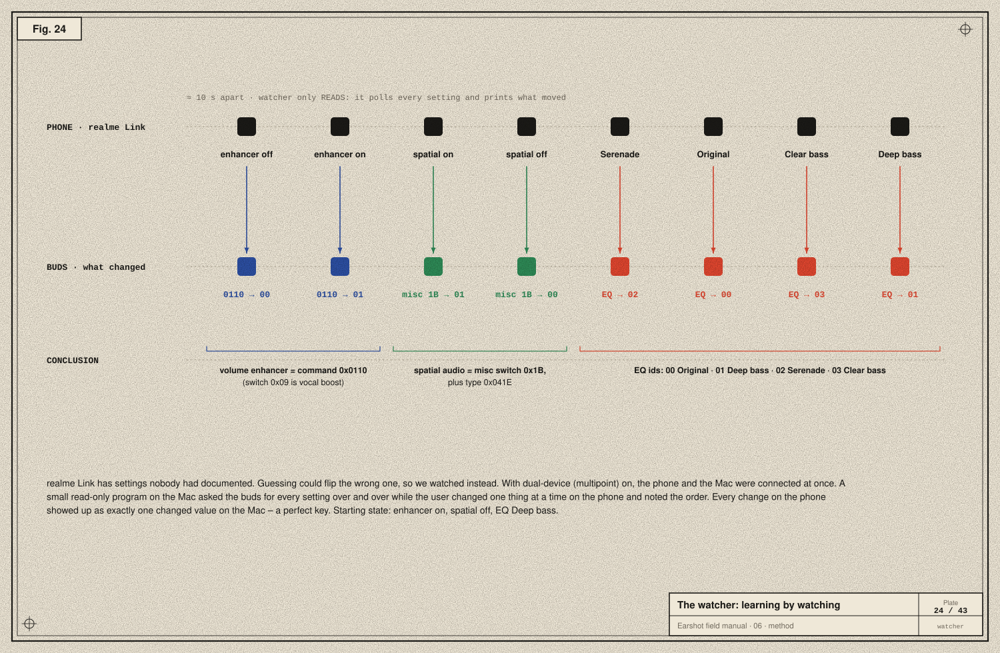
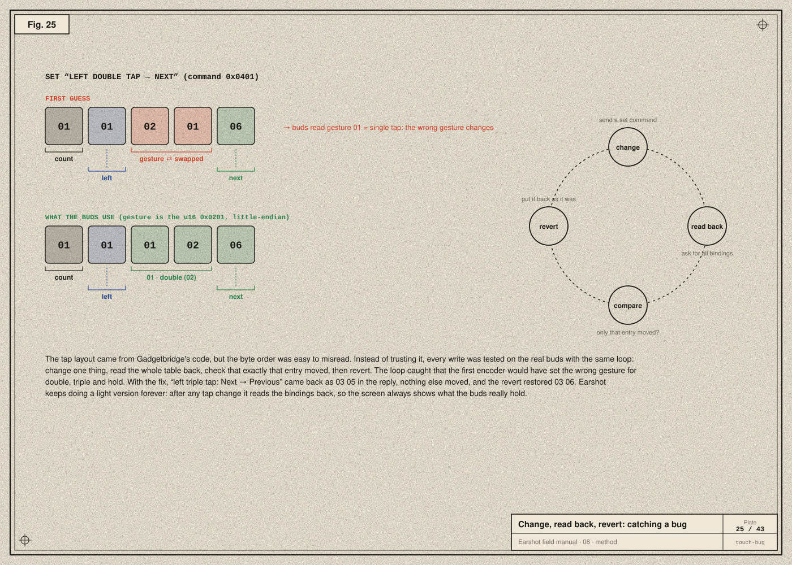

# 06 · The method: learning a language nobody wrote down

> **In the story:** realme publishes nothing. Gadgetbridge got us started, but EQ, the volume enhancer and spatial audio were undocumented, and one encoder had a hidden bug. This is the careful method that solved both.

realme publishes no documentation for its control protocol. Everything Earshot knows was learned. This chapter describes the method, which works for almost any device. It is careful by design, because a wrong guess can change a setting you didn't mean to.

## 1 · Start from prior art

Before touching the device, read what others have learned:

- **Gadgetbridge**, a free Android app for wearables, has code for OPPO / realme / OnePlus buds, Sony, Nothing, soundcore and more. Its source is the closest thing to a specification. It covers command numbers, payload layouts and quirks.
- **GalaxyBudsClient** documents Samsung's messages, with captured examples.
- A blog post and repository on **cracking OnePlus Buds** showed the OPO family could be driven from a computer.

Prior art gives you a hypothesis: *this byte sequence should mean "battery?"* It isn't proof. Your model and firmware may differ, and several things did.

## 2 · Probe read-only first

Reading can't hurt a device; writing can. So the first contact was all **requests that only ask**: battery, wear status, noise mode, firmware, switches. If the replies make sense (the left bud really is at 10 %, the firmware really is 1.1.0.62), your framing and command numbers are right.

The first replies also exposed differences from the references:
- The Buds Air 7 report a hi-res codec switch (`0x18`) that Gadgetbridge calls LDAC. On these buds it's **LHDC**.
- They answer a spatial-audio acknowledgement with a payload *shorter* than its declared length, so Earshot trusts the frame length over the payload-length field.
- The case reports `0` when it can't be read, which must not be shown as "empty".

## 3 · Differential observation: the watcher



Fourteen settings came back with no labels. Which one was the EQ? The volume enhancer? Spatial audio? Guessing by flipping each one would risk breaking something. Instead:

1. Turn on **dual-device (multipoint)**, so the phone and the Mac can both be connected.
2. Run a **read-only watcher** on the Mac that asks for every setting again and again and prints anything that changed.
3. On the phone, in the official app, change **one** feature at a time, about 10 seconds apart, and write down the order.

The user's notes were: *volume enhancer was on → off → on; spatial audio off → on → off; EQ Deep bass → Serenade → Original → Clear bass → Deep bass.* Matching those steps against the watcher's printout gave a perfect key:

| Feature | Where it lives | Values |
|---|---|---|
| Volume enhancer | its own command, `0x0110` (read) / `0x0407` (write). *Not* switch `0x09`, which is vocal enhancement | `00` / `01` |
| Spatial audio | misc switch `0x1B`, plus "spatial type" `0x041E`, which realme Link sends alongside | `00` / `01` |
| EQ preset | `0x010F` (read) / `0x0406` (write), plus a push `0x0504` when it changes | `00` Original · `01` Deep bass · `02` Serenade · `03` Clear bass |

This is the most powerful technique in the manual: **let the official app do the writing, and only watch.**

## 4 · Change, read back, revert



When you must write, write one thing and verify:

1. **Change** one setting.
2. **Read** the whole table back.
3. **Compare:** did exactly that entry move, and nothing else?
4. **Revert** to the original value.

The touch-binding encoder came from Gadgetbridge's layout, where a gesture is a 16-bit little-endian value `0x0201` (double tap), i.e. the bytes `01 02`. The first encoder wrote those two bytes swapped. The buds would have read gesture `01` (single tap) and changed the **wrong gesture** for double, triple and hold.

The loop caught it before it shipped. Testing "left triple tap: Next → Previous" with the fixed encoder: the reply showed exactly one change, `03 05` (triple → previous); then the revert restored `03 06`. Earshot keeps a light version of this forever: after any tap change, it re-reads the bindings, so the screen always shows what the buds really hold.

## 5 · Freeze what you learned as tests

Every real reply became a **test vector**: a hex string in `Tests/EarshotCoreTests/ProtocolTests.swift` with the meaning it must decode to:

```swift
// Captured from a realme Buds Air 7 (left bud 10%, right bud flat, ANC on).
@Test func parsesBatteryReplySkippingUnreadableCase() {
    #expect(parse("AA 0D 00 00 06 81 00 06 00 00 02 01 0A 03 00")
            == [.battery([BatteryReading(slot: .left, level: 10, charging: false)])])
}
```

Now the knowledge can't silently rot: any refactor that breaks decoding fails the build. For brands we don't own, the tests use messages other people captured from real devices (GalaxyBudsClient and Gadgetbridge test data).

## 6 · When you don't own the device: ask for a report

For the six other brand families, there was no hardware to test on. So:
- Each is labelled **beta** in the app.
- Settings → **Report → Save** writes the last 600 frames sent and received, with timestamps and notes, to a text file. Device addresses are left out.
- A GitHub issue template asks owners to attach it.

One report from a real owner confirms or corrects a protocol faster than any amount of reading ([chapter 10](10-the-app.md) shows the journal).

## Safety rules we followed

- Read before you write. Write one thing at a time. Always know how to undo it.
- Never send firmware-update or factory-reset commands, even if you know them.
- Prefer watching the official app over guessing.
- Trust the device over the documentation, but write down every difference.

Next: [07 · OPO byte by byte →](07-opo-byte-by-byte.md)
