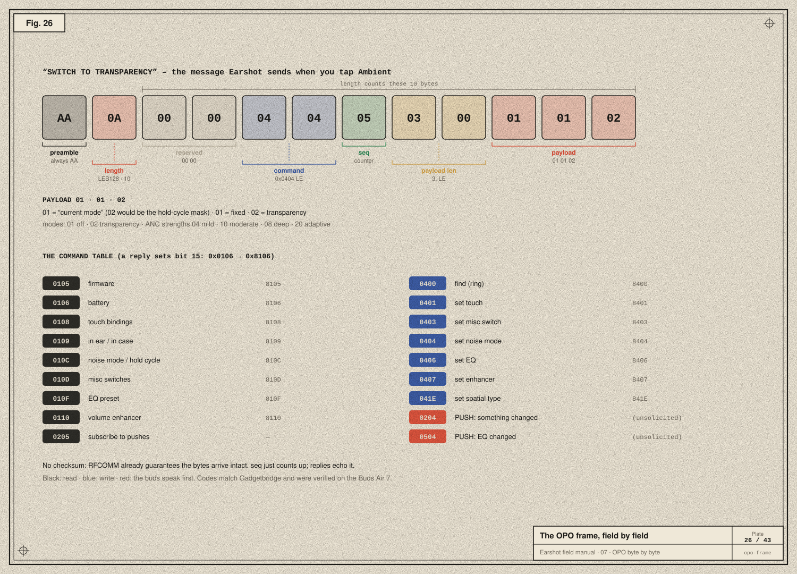
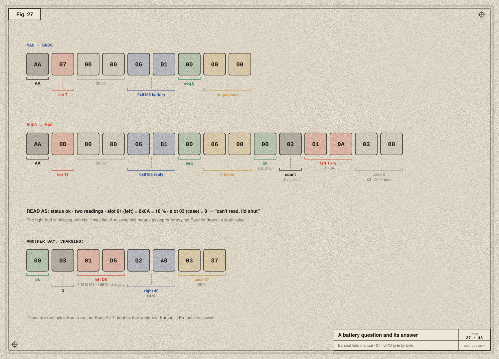
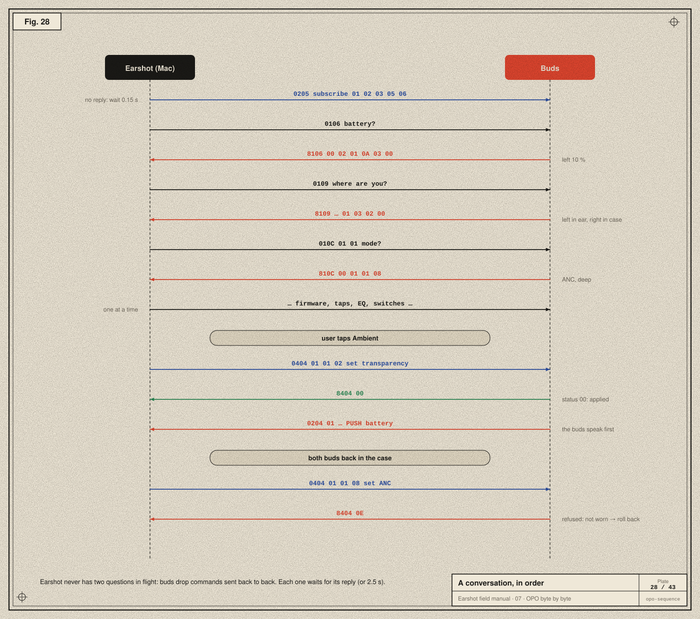
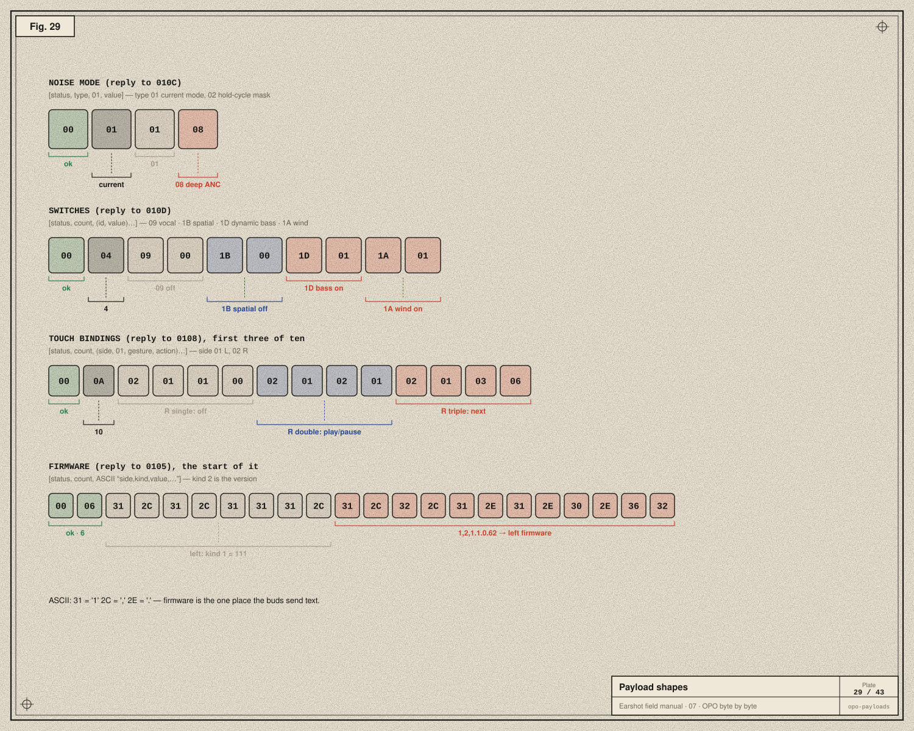

# 07 · OPO byte by byte

> **In the story:** channel 15 is open and the buds answer. Now we have to speak their language fluently: every field, every command, every quirk. This is the protocol Earshot was born speaking.

realme, OPPO and OnePlus belong to the same group of companies, and their buds share one control protocol. We call it **OPO** after the three names. It runs over the RFCOMM service `0000079A-D102-11E1-9B23-00025B00A5A5` (channel 15 on the Buds Air 7). Command numbers match Gadgetbridge's OPPO code, and everything below was verified against a realme Buds Air 7 on firmware 1.1.0.62.

## The frame



```
AA <len: LEB128> 00 00 <cmd: u16 LE> <seq: u8> <payloadLen: u16 LE> <payload…>
```

| Field | Size | Meaning |
|---|---|---|
| preamble | 1 | always `AA`, the start marker the decoder hunts for |
| length | 1–2 | LEB128, counts everything *after* itself (7 header bytes + payload) |
| reserved | 2 | `00 00` |
| command | 2 | little-endian; replies set bit 15 (`0x0106` → `0x8106`) |
| seq | 1 | a counter Earshot increments per message; replies echo it |
| payload length | 2 | little-endian |
| payload | n | command-specific |

There is **no checksum**. RFCOMM already guarantees ordered, intact delivery ([chapter 08](08-integrity.md)). One quirk: some Buds Air 7 replies declare a payload length longer than they carry, so Earshot's decoder trusts the outer frame length.

Earshot builds a frame like this:

```swift
public func encoded() -> [UInt8] {
    let body = 7 + payload.count
    var out: [UInt8] = [0xAA]
    out += LEB128.encode(UInt(body))
    out += [0x00, 0x00, UInt8(command & 0xFF), UInt8(command >> 8), seq]
    out += [UInt8(payload.count & 0xFF), UInt8((payload.count >> 8) & 0xFF)]
    out += payload
    return out
}
```

## The commands

| Request | Meaning | Reply |
|---|---|---|
| `0105` | firmware versions | `8105` |
| `0106` | battery | `8106` |
| `0108` | touch bindings | `8108` |
| `0109` | wear status (in ear / out / case) | `8109` |
| `010C` | noise mode, or hold-cycle mask | `810C` |
| `010D` | misc switches | `810D` |
| `010F` | EQ preset | `810F` |
| `0110` | volume enhancer | `8110` |
| `0205` | subscribe to pushes | *(none)* |
| `0400` | find: ring / stop | `8400` |
| `0401` | set touch binding | `8401` |
| `0403` | set misc switch | `8403` |
| `0404` | set noise mode / hold cycle | `8404` |
| `0406` | set EQ | `8406` |
| `0407` | set volume enhancer | `8407` |
| `041E` | set spatial type | `841E` |
| `0204` | **push**: battery, wear, noise or game mode changed | — |
| `0504` | **push**: EQ changed | — |

Reads start `01`, writes start `04`, and pushes come from the buds on their own.

## A question and its answer



The request `AA 07 00 00 06 01 00 00 00` is:
- the preamble, then length 7;
- reserved `00 00`;
- command `06 01` = `0x0106` battery;
- seq 0, payload length 0.

The reply `AA 0D 00 00 06 81 00 06 00 00 02 01 0A 03 00` decodes as:
- `06 81` = `0x8106`, the battery reply;
- the payload `00 02 01 0A 03 00`:
  - status `00` (ok);
  - `02` readings;
  - slot `01` (left) = `0x0A` = 10 %;
  - slot `03` (case) = `0`, which Earshot skips because a zero with no charging flag means "can't read".

Slot `02` (right) is missing entirely: that bud was flat.

Each level byte also carries the charging flag in its top bit. `D5` = charging + 85 %.

## A conversation



When the channel opens, `OPODriver.start()` queues:

1. `0205` **subscribe** with `09 01 02 03 05 06`: please push battery, wear, noise-mode and game-mode changes. It's never acknowledged, so the link waits 0.15 s instead of for a reply.
2. Battery, wear status, noise mode, hold cycle, misc switches, firmware, touch bindings, EQ and volume enhancer, **one at a time**.

Then every 90 s it polls battery and wear status, and the buds push changes as they happen (`0204`).

## Payload shapes



**Noise mode** (`810C` reply): `[status, type, 01, value]`.
- Type `01` is the current mode:
  - `01` off, `02` transparency;
  - ANC strengths `04` mild, `10` moderate, `08` deep, `20` adaptive.
- Type `02` is the hold-cycle bitmask ([chapter 02](02-signals-to-bits.md)).

To set transparency, Earshot sends `0404` with `01 01 02`. To set ANC, it sends the *strength* code: there is no separate "ANC on". To change the hold cycle, it sends `0404` with `02 01 <mask>`.

**Misc switches** (`810D` reply): `[status, count, (id, value)…]`.

| id | Switch |
|---|---|
| `06` | game mode |
| `09` | vocal enhancement |
| `11` | dual-device |
| `18` | hi-res codec (LHDC) |
| `1A` | wind-noise reduction |
| `1B` | spatial audio |
| `1D` | dynamic bass |

To change one, Earshot sends `0403` with `[id, 00|01]`. For spatial audio it also sends `041E [00|01]`, as realme Link does.

**Touch bindings** (`8108` reply): `[status, count, (side, 01, gesture, action)…]`.
- Sides: `01` left, `02` right.
- Gestures: `01` single, `02` double, `03` triple, `04` hold.
- Actions: `00` none, `01` play/pause, `04` assistant, `05` previous, `06` next, `08` noise control, `0B` volume up, `0C` volume down, `11` game mode.
- To set one: `0401 [01, side, 01, gesture, action]`.

**Firmware** (`8105` reply): status, count, then **ASCII text**, `"side,kind,value,…"`. Kind `2` is the version: `1,2,1.1.0.62` means left bud firmware 1.1.0.62. It's the only text the buds ever send.

**EQ:** `810F [00, id]` and pushes `0504 [00, id]`.

| id | Preset |
|---|---|
| `00` | Original |
| `01` | Deep bass |
| `02` | Serenade |
| `03` | Clear bass |

## Acknowledgements and refusals

Every write is answered with the same command plus `0x8000`, and a **status byte**:

| Status | Meaning |
|---|---|
| `00` | applied |
| `0E` | refused: no bud in an ear (the Buds Air 7 refuse noise changes then) |
| other | refused, reason unknown, shown as its hex code |

A reply doesn't say *which* setting it answers, only which command. Two different misc switches share `0403`. So `OPODriver.frame()` records, per command, which setting was last written, and attributes the acknowledgement to it:

```swift
public func frame(_ message: Outgoing) -> [UInt8] {
    let command = u16(message.body[0], message.body[1])
    if let setting = message.setting { lastSetting[command] = setting }
    defer { seq &+= 1 }
    return OPOPacket(command: command, seq: seq, payload: Array(message.body[2...])).encoded()
}
```

After a refusal, or after any touch or enhancer change, the driver reads the setting back, so the UI shows the truth.

Next: [08 · Integrity →](08-integrity.md)
