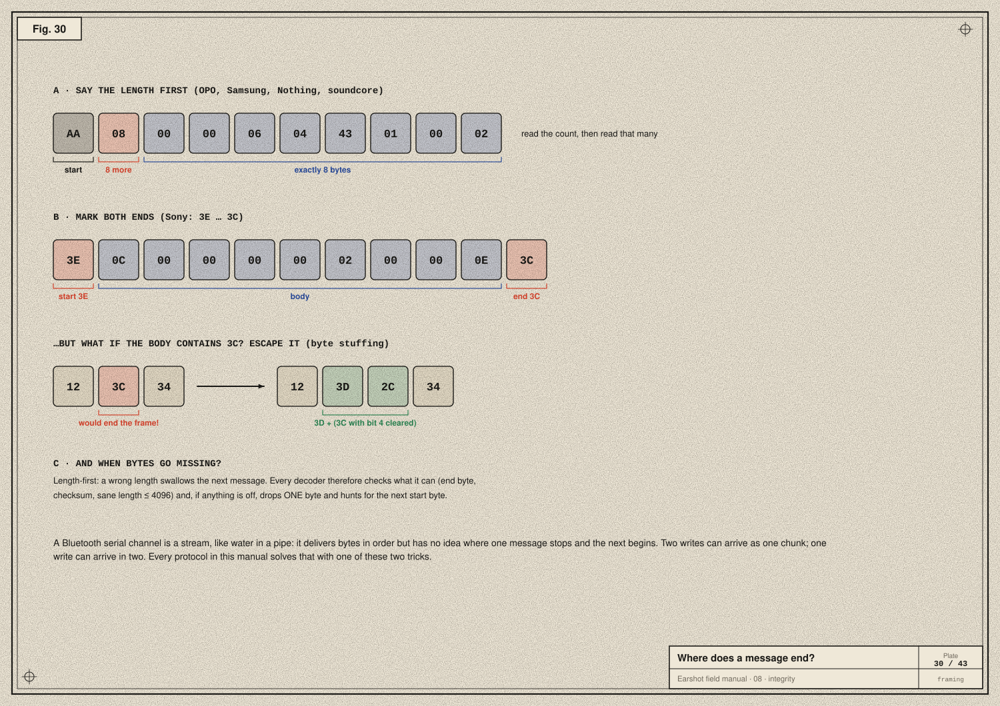
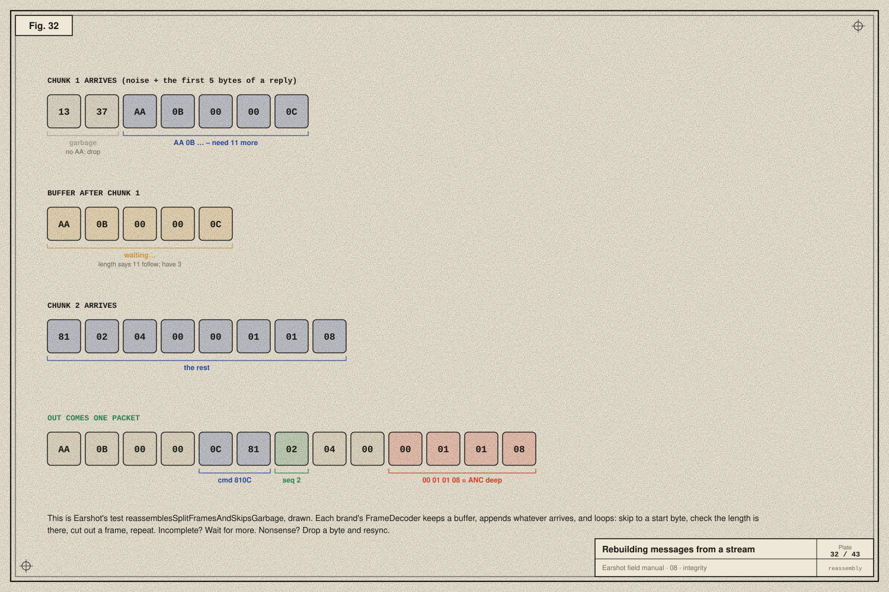
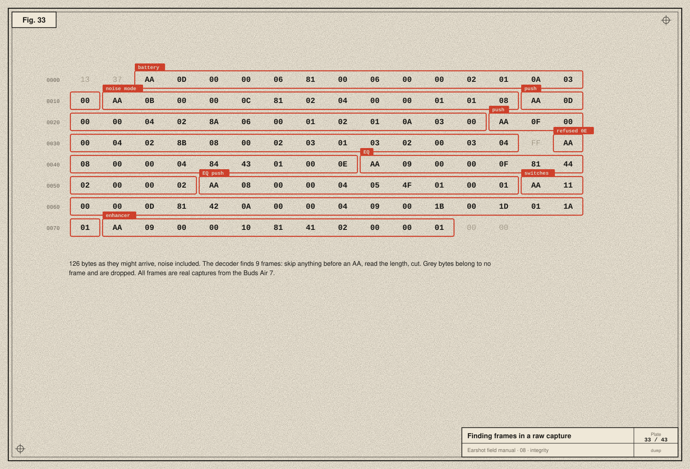
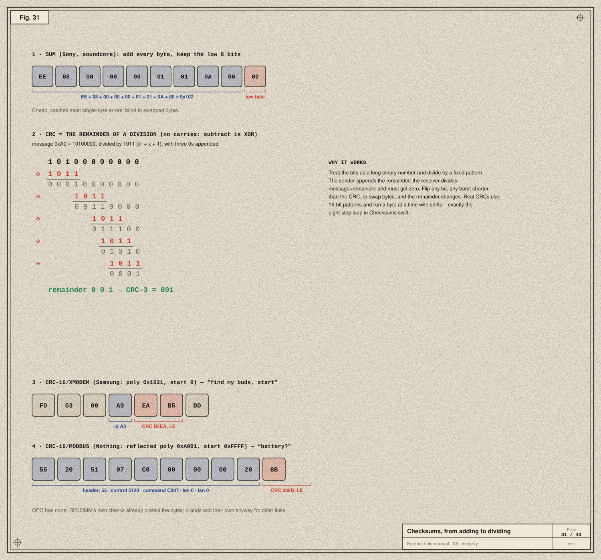

# 08 · Integrity: where messages begin, end, and stay correct

> **In the story:** the first replies sometimes arrived glued together, or split across two callbacks. The decoder had to learn to find the edges of messages in a stream of bytes, and the other brands each protect their messages differently. This chapter is the theory behind all of that.

## A stream has no edges

An RFCOMM channel is like a pipe of water: bytes come out in the order they went in, but there are no gaps between "messages". Two writes can arrive as one chunk; one write can arrive in two. Every protocol needs a **framing** rule.



**A · Length first.** Start with a recognisable byte, then say how many bytes follow. The reader takes the count and reads exactly that many.

| Protocol | Start | Length field |
|---|---|---|
| OPO | `AA` | LEB128 |
| Samsung | `FD` | 10-bit size, ending `DD` |
| Nothing | `55` | a 16-bit length |
| soundcore | `EE`/`FF` | a 16-bit total |

The risk: if the length is corrupted, you swallow part of the next message.

**B · Mark both ends.** Sony starts every frame with `3E` and ends it with `3C`. Simple, but what if a `3C` appears *inside* the message? It must be **escaped** (byte stuffing):
- Sony replaces any `3C`, `3D` or `3E` in the body with `3D` followed by the byte with bit 4 cleared, so `3C` becomes `3D 2C`.
- The reader reverses it: after a `3D`, OR the next byte with `0x10`.

```swift
static func escape(_ bytes: [UInt8]) -> [UInt8] {
    bytes.flatMap { [0x3C, 0x3D, 0x3E].contains($0) ? [0x3D, $0 & 0xEF] : [$0] }
}
```

**C · Recovering.** Any decoder will eventually see garbage: a byte lost, a frame cut by a disconnect. Earshot's decoders check everything they can: start byte, end byte, checksum, and a sane length of at most 4096. If anything is off they **drop one byte and hunt for the next start byte**. This *resync* means one bad byte costs at most one message, never the connection.

## Rebuilding messages from chunks



Every brand's `FrameDecoder` has the same loop:

```swift
public mutating func feed(_ bytes: [UInt8]) -> [OPOPacket] {
    buffer += bytes
    var packets: [OPOPacket] = []
    while !buffer.isEmpty {
        guard buffer[0] == 0xAA else {                     // resync on the next preamble
            buffer.removeFirst(buffer.firstIndex(of: 0xAA) ?? buffer.count)
            continue
        }
        guard let (length, lenSize) = LEB128.decode(buffer[1...]) else { break }    // need more bytes
        guard length >= 7, length <= 4096 else { buffer.removeFirst(); continue }   // nonsense: skip
        let start = 1 + lenSize
        guard buffer.count >= start + length else { break }                       // incomplete: wait
        let body = Array(buffer[start..<(start + length)])
        buffer.removeFirst(start + length)
        packets.append(OPOPacket(command: UInt16(body[2]) | UInt16(body[3]) << 8, seq: body[4], payload: Array(body[7...])))
    }
    return packets
}
```

The test `reassemblesSplitFramesAndSkipsGarbage` feeds `13 37` plus the first five bytes of a reply, gets nothing, then feeds the rest and gets exactly one packet: ANC, deep.

## Seeing it on a raw capture



Here are 126 bytes as they might arrive, with stray bytes mixed in. Walking them the way the decoder does finds nine frames: battery, noise mode, two pushes, a refusal, EQ, an EQ push, switches and the enhancer. The grey bytes belong to nothing and are dropped.

## Checksums: did the bytes change?



Radio links have their own error checks ([chapter 04](04-the-bluetooth-stack.md)), but many brands add one inside their messages too. Their protocols were designed for older or rougher links, and it costs little.

**Sum.** Add every byte and keep the low 8 bits. Sony and soundcore use it. It's cheap and catches most single-byte errors, but it's blind to swapped bytes, since addition doesn't care about order.

**CRC (cyclic redundancy check).** Treat the whole message as one long binary number and divide it by a fixed binary pattern, the *generator polynomial*. The arithmetic has no carries: subtraction is XOR. The **remainder** is the CRC.
- The sender appends it.
- The receiver divides message + CRC and must get zero.

The plate works a tiny 3-bit example by hand. Real CRCs use 16-bit generators and process a byte at a time with shifts. They detect every single-bit error, every two-bit error, any odd number of flipped bits, and any burst shorter than the CRC.

Two CRC-16 variants appear in Earshot:

```swift
/// CRC-16/XMODEM (poly 0x1021, init 0), used by Samsung.
static func crc16Xmodem(_ bytes: [UInt8]) -> UInt16 {
    var crc: UInt16 = 0
    for byte in bytes {
        crc ^= UInt16(byte) << 8
        for _ in 0..<8 { crc = crc & 0x8000 != 0 ? (crc << 1) ^ 0x1021 : crc << 1 }
    }
    return crc
}

/// CRC-16/MODBUS (reflected poly 0xA001, init 0xFFFF), used by Nothing.
static func crc16Modbus(_ bytes: [UInt8]) -> UInt16 {
    var crc: UInt16 = 0xFFFF
    for byte in bytes {
        crc ^= UInt16(byte)
        for _ in 0..<8 { crc = crc & 1 != 0 ? (crc >> 1) ^ 0xA001 : crc >> 1 }
    }
    return crc
}
```

They differ in three ways:
- **Bit direction:** XMODEM processes the high bit first; MODBUS is "reflected" and processes the low bit first, so its polynomial 0x8005 appears reversed as 0xA001.
- **Starting value:** 0 versus 0xFFFF.
- **Byte order of the result:** both are sent little-endian here.

One real-world wrinkle: Nothing's *incoming* CRCs in published captures don't match CRC-16/MODBUS, so, like Gadgetbridge, Earshot computes the CRC on what it sends but doesn't reject replies over it. Trust the device.

## Sequence numbers and acknowledgements

Framing finds messages; numbering keeps them in order and pairs answers with questions:

- **OPO:** a `seq` byte that the reply echoes, plus a status byte.
- **Sony:** every frame must be **ACKed** with a tiny frame carrying the other side's sequence number flipped (`1 − seq`). Miss an ACK and the headphones resend. Earshot's Sony driver writes these ACKs immediately, ahead of its queue (`Inbound.immediate`).
- **Nothing:** a frame sequence number (`fsn`), with a control bit saying it is in use.
- **Samsung:** no acknowledgement at all. The buds simply push their new status; Earshot marks a change as applied as soon as it's written (`appliedOnWrite`).

## Take-aways

- Streams need framing: length-prefixed or delimited, with escaping.
- Decoders must buffer, wait and resync.
- Checksums range from a simple sum to CRCs, which are polynomial division without carries.
- Sequence numbers and ACKs pair answers with questions, and every brand does it differently.

Next: [09 · The other brands →](09-the-other-brands.md)
