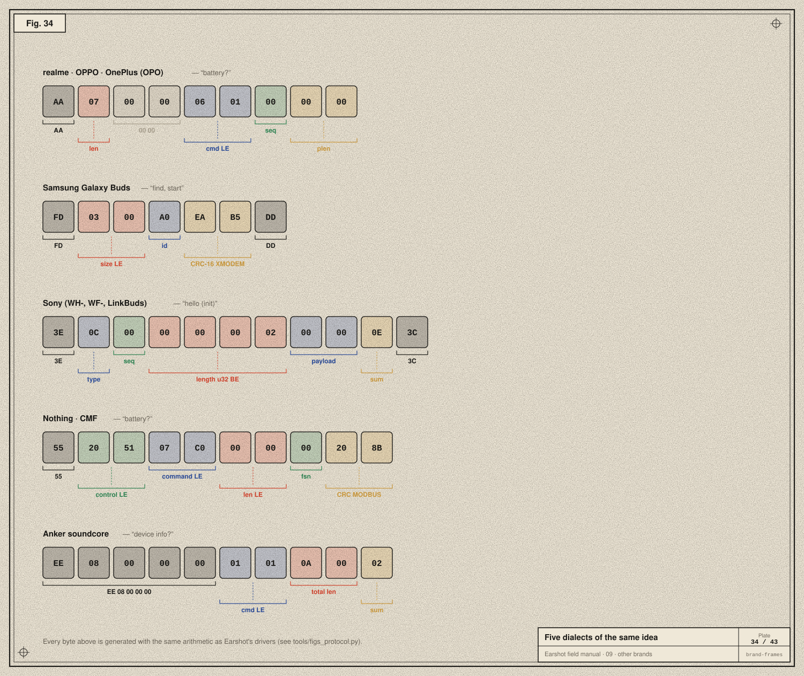
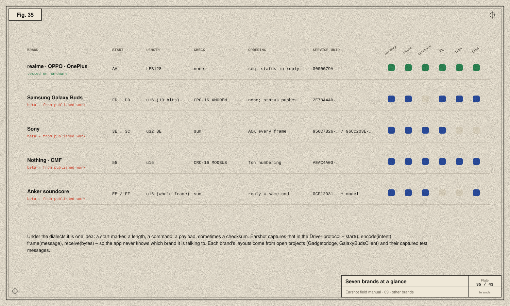

# 09 · The other brands

> **In the story:** after v1.0, the question was *"Most earbuds that are not Apple, the ones sold in India and English-speaking countries. I don't have them. Is that doable?"* This chapter is the answer: five protocol families, learned from open work and captured messages, behind one interface.



Every byte in this plate was computed with the same arithmetic as Earshot's drivers. You can check them by running `tools/figs_protocol.py`.

## realme · OPPO · OnePlus: OPO

[Chapter 07](07-opo-byte-by-byte.md). Tested on the realme Buds Air 7. Other realme, OPPO Enco and OnePlus Buds use the same driver and are marked beta. Their companion app is named in the UI ("realme Link" or "HeyMelody").

## Samsung Galaxy Buds

```
FD <header: u16 LE> <id> <payload…> <crc16: u16 LE> DD
```

- **Service:** `2E73A4AD-332D-41FC-90E2-16BEF06523F2` on Buds2 and later, else plain SPP `00001101-…`.
- **Header:** the low 10 bits count id + payload + CRC.
- **Check:** CRC-16/XMODEM over id and payload.
- **Status:** the buds push it on their own.
  - `0x61` *extended status* arrives on connect. On Buds Live and later its layout is: `[2]` left %, `[3]` right %, `[6]` placement as two nibbles (left high, right low), `[7]` case %, `[8]` game mode, `[9]` EQ, `[11]` hold actions (nibbles), `[12]` noise mode. The Buds+ uses different offsets.
  - `0x60` *status update* comes later.
- **Writes:**

  | id | Sets |
  |---|---|
  | `0x78` | noise control: 0 off, 1 ANC, 2 ambient, 3 adaptive |
  | `0x80` | ambient, on the Buds+ |
  | `0x98` | ANC, on the Buds Live |
  | `0x86` | EQ preset, 0–5 |
  | `0x85` | game mode |
  | `0x92` | touch-and-hold actions `[left, right]`: 1 assistant, 2 noise, 3 volume, 4 Spotify |
  | `0xA0` / `0xA1` | find start / stop |

- On connect Earshot sends a "manager info" message (`0x88 [01 01 22]`) to introduce itself.
- Nothing is acknowledged, so changes count as applied when written, and the next status push shows the truth.
- **Model:** detected from the name, e.g. "Galaxy Buds2 Pro (A1B2)", even if renamed. The model decides which noise modes exist and whether hold actions are configurable.

## Sony (WH-, WF-, LinkBuds, ULT Wear)

```
3E <type> <seq> <length: u32 BE> <payload…> <sum> 3C
```

- **Service:** `956C7B26-D49A-4BA8-B03F-B17D393CB6E2` (newer) or `96CC203E-5068-46AD-B32D-E316F5E069BA` (older).
- **Framing:** delimited and escaped ([chapter 08](08-integrity.md)). The checksum is the byte sum of type through payload.
- **Types:** `0x01` ACK, `0x0C` / `0x0E` commands. Every command is ACKed with `seq = 1 − theirs`, and Earshot updates its own seq from their ACK.
- **Hello:** the init command is payload `00 00`. A 4-byte reply means protocol v1; an 8-byte reply means v2. The version picks every later layout:

  | Topic | v1 | v2 |
  |---|---|---|
  | Battery | `[10 type]` → `0x11`/`0x13` | `[22 type]` → `0x23`/`0x25` |
  | Ambient / ANC | get `0x66`, set `0x68`, variant `02` | same commands, variants `0x15`, `0x17`, `0x22` |
  | EQ | `[56/58, 01, preset, 00]` | `[56/58, 00, preset, 00]` |

  - Battery types: single, dual, case.
  - Ambient / ANC replies arrive as `0x67`/`0x69`.
  - EQ presets: off, or `0x10`–`0x17`.
- **Product:** headphones (WH-, ULT Wear) show one battery and a headphones sprite.

## Nothing · CMF

```
55 <control: u16 LE> <command: u16 LE> <length: u16 LE> <fsn> <payload…> <crc16: u16 LE>
```

- **Service:** `AEAC4A03-DFF5-498F-843A-34487CF133EB`.
- **Control word:**
  - bit `0x20` means a CRC follows (CRC-16/MODBUS over everything before it);
  - the low 5 bits are a reply's status;
  - bit `0x40` means frames are numbered (the Ear (a) needs it).
- **Commands:**

  | Topic | Read | Push | Write |
  |---|---|---|---|
  | Battery | `C007` (sent with control `0x5120`) | `E001` | — |
  | Audio mode | `C01E` | `E003` | `F00F [01, mode, 00]` |
  | EQ | `C050` | — | `F01D` |
  | Ultra bass | `C04E` | — | `F051` |
  | Spatial | `C04F` | — | `F052` |
  | Low latency (1 on, 2 off) | `C041` | — | `F040` |
  | Taps | `C018` | — | `F003` |
  | Find | — | — | `F002` |

  - Audio modes: `05` off, `07` transparency, `01` high, `02` mid, `03` light, `04` adaptive.
  - Tap gestures: `02` double, `03` triple, `07` hold.
- **Product:** capabilities depend on the name. "Ear (stick)" has no noise control, "Ear (1)" no adaptive ANC, and CMF models get EQ presets.

## Anker soundcore

```
host:   EE 08 00 00 00 <command: u16 LE> <length: u16 LE> <payload…> <sum>
device: FF 09 00 00 01 <command: u16 LE> <length: u16 LE> <payload…> <sum>
```

- **Service:** a UUID starting `0CF12D31-FAC3-4553-BD80-D6832E7…` that **ends in the model number**, which is why Earshot's `ServiceMatch` has a `.prefix` case.
- **Framing:** `length` counts the whole frame; the checksum is the byte sum before it.
- **Commands:**

  | Command | Purpose |
  |---|---|
  | `0101` | device info |
  | `0105` | extended info |
  | `8105` | session init |
  | `0301` | battery |
  | `0401` | charging |
  | `0106` | audio mode |
  | `8106` | set audio mode, with a model-specific trailer (`01`, or `01 00` on the Liberty 4 NC) |
  | `8910` | find |

  - Battery comes in fifths (raw × 20), or (raw + 1) × 10 on some newer models.
  - Audio-mode payload: `[mode 0 ANC / 1 ambient / 2 off, strength 10/20/30, …]`.
- **Product:** which noise modes exist is learned from the first audio-mode report.

## At a glance



## One interface for all of them

The app never knows which brand it's talking to. Each brand implements the same small protocol (`EarshotCore/Driver.swift`):

```swift
public protocol Driver: AnyObject {
    var capabilities: Capabilities { get }            // which controls to show
    func start() -> [Outgoing]                       // sent once the channel opens
    func poll() -> [Outgoing]                        // every 90 s
    func encode(_ intent: Intent) -> [Outgoing]      // "set ANC deep" → messages
    func frame(_ message: Outgoing) -> [UInt8]       // final bytes at send time (seq numbers)
    func receive(_ bytes: [UInt8]) -> Inbound        // bytes → events, replies, ACKs
}
```

- **Capabilities** list what a model can do, so the UI shows only controls that work.
- **Intents** are brand-neutral requests: `setNoise(.cancel, level: .deep)`, `setEq(2)`, `setTouch(…)`, `find(true)`.
- **Events** are brand-neutral facts: `.battery([…])`, `.placement([…])`, `.noiseMode(…)`, `.applied(.noise)`, `.refused(.noise, code: 0x0E)`.

Adding a brand means writing one driver and one profile. The UI, the link and the store don't change.

## Honesty about "beta"

Only the Buds Air 7 has been tried on real hardware. Every other family is built from published protocol work and other people's captured messages. The parsers are tested against those captures, but behaviour such as timing, refusals and model quirks can only be confirmed by an owner. The app shows **beta** in the header for those models, and asks for a report.

Next: [10 · The app →](10-the-app.md)
