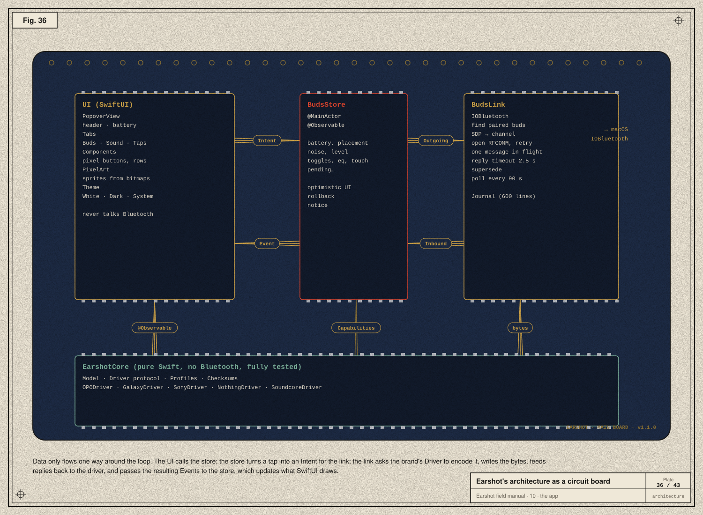
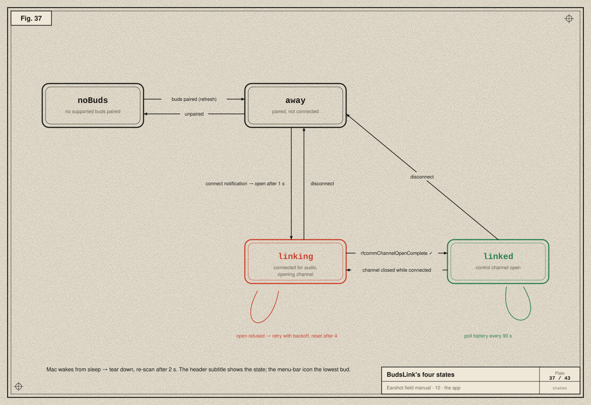
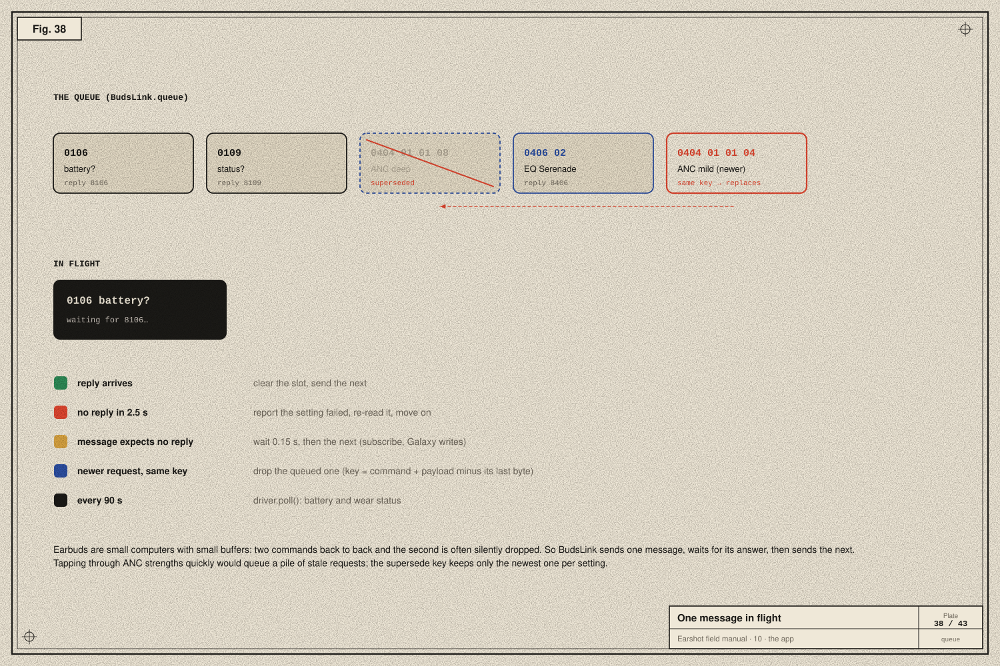
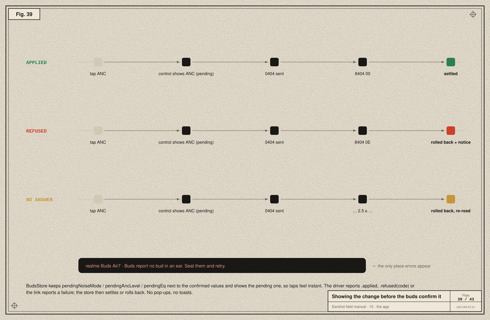
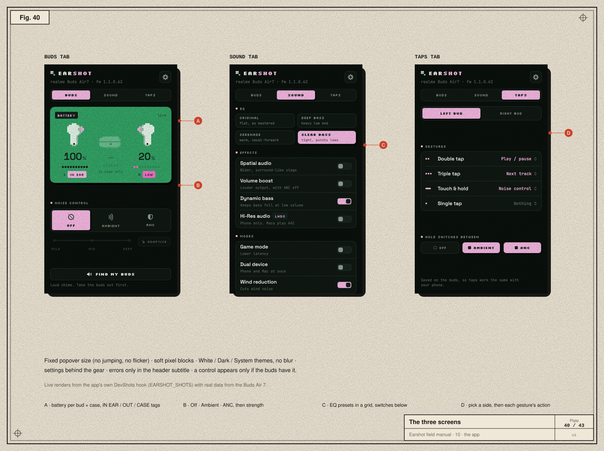
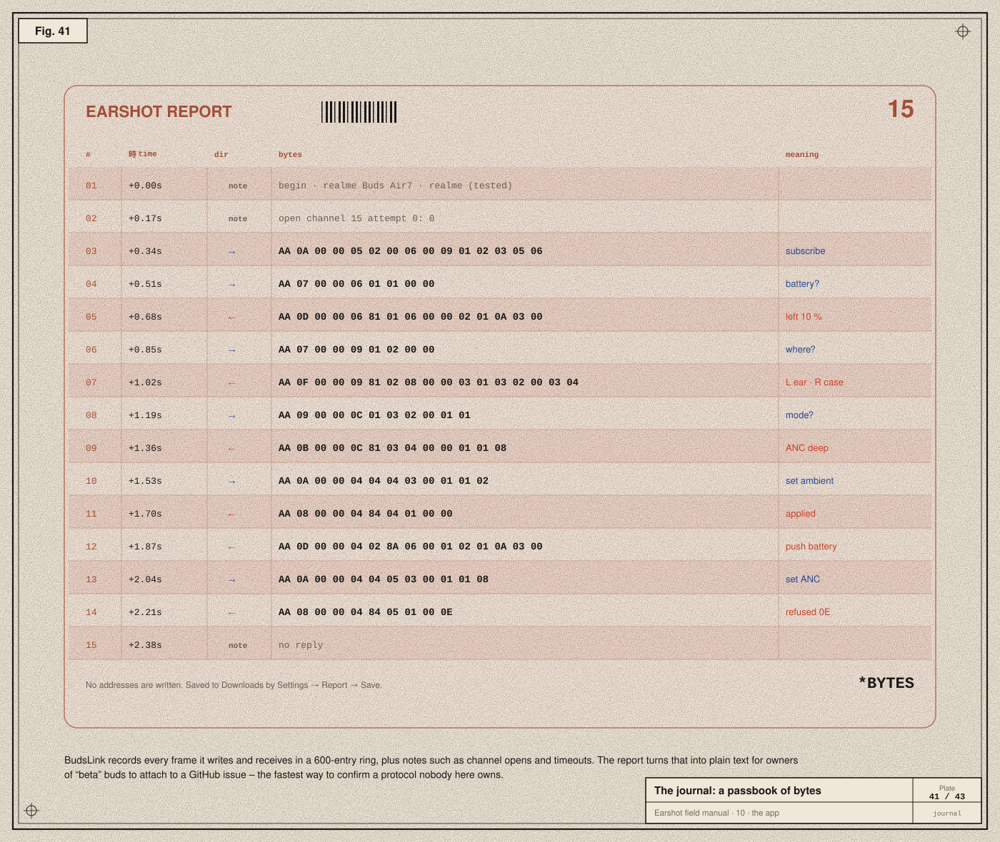

# 10 · The app

> **In the story:** with a working protocol, the user asked for *"a beautiful app… prod level"*, in the same design language as their other projects. Then the real-world problems arrived: flicker, stuck links, ugly notifications. This chapter is the app that came out of that, and why it's shaped the way it is.



Earshot is a Swift package with three targets (`Package.swift`):

| Target | What it is |
|---|---|
| **EarshotCore** | Pure protocol code: the model, the Driver protocol, five drivers, profiles, checksums. **No Bluetooth, no UI**, so every byte of it can be unit-tested. |
| **Earshot** | The menu-bar app: `BudsLink` (IOBluetooth), `BudsStore` (state), SwiftUI views, `Journal`. |
| **EarshotCoreTests** | Swift Testing tests with captured bytes. |

Data flows one way around a loop:

1. **UI → store:** you tap "Ambient".
2. **Store → link:** `budsLink.send(.setNoise(.transparency, level: nil))`.
3. **Link → driver:** `driver.encode(intent)` returns `Outgoing` messages; the link queues them, frames them with `driver.frame()`, and writes them.
4. **Bytes back → driver:** `driver.receive(bytes)` returns an `Inbound`: events, matched reply keys, follow-up reads and immediate ACKs.
5. **Link → store:** events like `.noiseMode(.transparency, level: nil)` or `.applied(.noise)`.
6. **Store → UI:** `@Observable` properties change, and SwiftUI redraws.

## BudsLink: the link's four states



`BudsLink.State` is one of:

| State | Meaning |
|---|---|
| `noBuds` | no supported buds are paired |
| `away(name)` | paired, but not connected (in the case, or on another device) |
| `linking(name)` | connected for audio, opening the control channel |
| `linked(name)` | channel open, driver running |

- **Transitions** come from IOBluetooth notifications (connect, disconnect), channel callbacks (open complete, closed), the retry timers ([chapter 05](05-finding-the-door-on-macos.md)), and the Mac waking from sleep, which tears down and re-scans after 2 s.
- **The header subtitle** shows the state; the **menu-bar** shows the lowest bud's battery.
- **IOBluetooth** delivers every callback on the main run loop, so all link state lives on the `@MainActor`. No locks needed.

## One message in flight



Earbuds are small computers with small buffers: send two commands back to back and the second is often dropped silently. So `BudsLink.pump()` sends **one** message and waits.

| What happens | What the link does |
|---|---|
| reply key arrives | clears the slot and sends the next message |
| no reply in **2.5 s** | reports that setting as failed, re-reads it, moves on |
| message expects no reply (subscribe, Samsung writes) | waits **0.15 s**, then continues |
| a newer request with the same **supersede key** | the older queued one is removed |
| every **90 s** | `driver.poll()` refreshes battery and wear status |

The supersede key is the command plus the payload minus its last byte, i.e. "which setting" without "which value". If you click through ANC strengths quickly, only the last one is sent.

Each message is an `Outgoing`:

```swift
public struct Outgoing: Equatable, Sendable {
    public var body: [UInt8]              // driver-specific; framed at send time
    public var reply: UInt32?             // what to wait for; nil = short gap
    public var setting: Setting?          // reported failed if no reply comes
    public var supersedes: [UInt8]?       // newer same-key messages replace this one
    public var appliedOnWrite = false     // for brands that never confirm (Samsung)
}
```

## BudsStore: showing the change before it's confirmed



Waiting 100–300 ms for the buds to confirm a tap would feel sluggish. So the store is **optimistic**:

```swift
func setNoiseMode(_ mode: NoiseMode) {
    guard isLinked, mode != shownNoiseMode else { return }
    pendingNoiseMode = mode
    if mode == .cancel, let level = ancLevel { pendingAncLevel = level }   // ANC comes back at its old strength
    budsLink.send(.setNoise(mode, level: mode == .cancel ? ancLevel : nil))
}
var shownNoiseMode: NoiseMode? { pendingNoiseMode ?? noiseMode }
```

The control shows the pending value at once, and then one of three things happens:

| Outcome | What the store does |
|---|---|
| **Applied** | pending becomes the confirmed value |
| **Refused** | pending is cleared, the control springs back, and a short message appears in the header, e.g. *"Buds report no bud in an ear. Seat them and retry."* for status `0x0E` |
| **No answer** | pending is cleared, the setting is re-read, and *"The buds didn't answer. Is a bud asleep or out of range?"* |

When the link drops, the store clears **everything**: nothing it holds is trustworthy once the channel is gone.

## The screens



The design rules came from the user, sometimes bluntly:

- **No notifications.** *"So unneeded, horrible."* Errors appear only in the header subtitle, for four seconds. Success needs no message: the control settling is the confirmation.
- **No flicker, no jumping.** The popover has a fixed size. Controls never appear or disappear while open; they dim until linked. An `NSPopover` that resizes gets redrawn by macOS at the wrong size for a frame, so we never let it resize.
- **Don't clutter.** Three tabs:
  - **Buds:** battery card, noise control, ANC strength, find.
  - **Sound:** EQ grid, switches.
  - **Taps:** per-side gestures, hold cycle.

  Everything else (theme, launch at login, report, about) sits behind the gear.
- **Show only what works.** The driver's `Capabilities` decide which modes, strengths, presets, switches and gestures appear. A switch the model is known to have shows dimmed until the buds report it.
- **Pixel style.** Soft-cornered pixel blocks, bitmap sprites for the buds and case (and headphones for Sony WH-), three themes (White, Dark, System) and no blur, after oauth-ready's palette: pink `#F7B9E4`, ink `#13221A` and grain green `#2E9A5D`.

The README's screenshots aren't mock-ups. Launched with `EARSHOT_SHOTS=<dir>`, the app renders each tab of its real popover, with live data, to PNG (`DevShots.swift`).

## The journal



`Journal` is a ring of the last **600** entries: every frame sent (→), every chunk received (←), and notes like "open channel 15 attempt 0" or "no reply". **Settings → Report → Save** writes it as plain text to Downloads, as *Earshot report – \<name\>.txt*. The report includes the profile, firmware and capabilities, and never the Bluetooth address. Owners of beta buds attach it to a GitHub issue using the **Buds report** template.

## Small things that matter

- **One instance only:** two copies would fight over the channel.
- **Clean shutdown** on quit and SIGTERM, closing the channel so the next launch links instantly.
- **Launch at login** via `SMAppService.mainApp`.
- **Logging** with `os.Logger`, subsystem `xyz.srivtx.earshot`. Read it with:

  ```bash
  /usr/bin/log show --last 10m --predicate 'subsystem == "xyz.srivtx.earshot"'
  ```

  The full path matters: zsh has its own `log` built-in that shadows the system tool.

Next: [11 · Shipping →](11-shipping.md)
