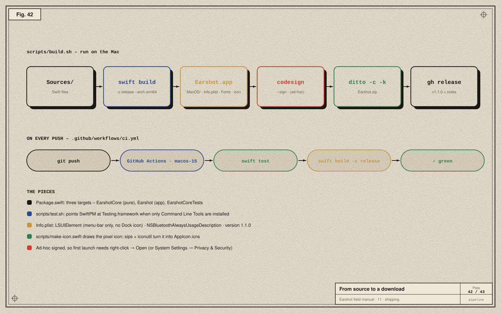

# 11 · Shipping

> **In the story:** *"All good, ship it."* Code on a laptop helps one person. This chapter is how Earshot became a download anyone can install, and how every push is checked automatically.



## The package

Earshot is a **Swift Package** with no Xcode project. `Package.swift` declares macOS 15 and three targets:
- **EarshotCore**, pure Swift;
- **Earshot**, an executable linking IOBluetooth and ServiceManagement;
- **EarshotCoreTests**.

Splitting the protocol code into its own target is what makes it testable without Bluetooth hardware.

## Tests

The tests use **Swift Testing** (`import Testing`, `@Test`, `#expect`). There are 45, covering:

- OPO framing, LEB128, and every reply type, with bytes captured from the Buds Air 7;
- the OPO driver's acknowledgement attribution and supersede keys;
- profile matching ("realme Buds Air7" is tested; "Air 7 Pro" is not);
- Samsung status messages captured by GalaxyBudsClient (Buds2 Pro, Buds2, Buds+, Live);
- Sony vectors from Gadgetbridge (EQ frame, escaping, handshake, battery, ambient v1 and v2);
- Nothing's captured EQ and bass messages, encoding, battery, noise and numbering;
- soundcore framing, battery in fifths, and the audio-mode trailer.

With full Xcode, `swift test` just works. With only the Command Line Tools installed, SwiftPM can't find the Testing framework on its own, so `scripts/test.sh` points it there:

```bash
swift test -Xswiftc -F -Xswiftc $F -Xlinker -F -Xlinker $F -Xlinker -rpath -Xlinker $F
# F=/Library/Developer/CommandLineTools/Library/Developer/Frameworks
```

## Building the app

A Mac app is a folder with a fixed shape. `scripts/build.sh` assembles it by hand:

```
Earshot.app/
  Contents/
    Info.plist                 ← name, version 1.1.0, LSUIElement, Bluetooth usage string
    MacOS/Earshot              ← swift build -c release --arch arm64
    Resources/AppIcon.icns     ← drawn by scripts/make-icon.swift, sized by sips, packed by iconutil
    Resources/Fonts/*.ttf
```

Key `Info.plist` entries:

| Key | Why |
|---|---|
| `LSUIElement = true` | a menu-bar app: no Dock icon, no app menu |
| `NSBluetoothAlwaysUsageDescription` | the sentence in the Bluetooth permission prompt; required |
| `CFBundleShortVersionString = 1.1.0`, build 3 | what users and updates see |

## Signing

macOS refuses to run unsigned code on Apple silicon. The build signs **ad-hoc**:

```bash
codesign --force --sign - --timestamp=none Earshot.app
```

Ad-hoc signatures aren't tied to a developer identity, so Gatekeeper warns the first time. You open it with right-click → Open, or allow it under System Settings → Privacy & Security. A Developer ID certificate and notarisation would remove that warning; they need a paid Apple developer account.

## Releasing

```bash
./scripts/build.sh
ditto -c -k --keepParent dist/Earshot.app Earshot.zip     # zip that preserves macOS metadata
gh release create v1.1.0 Earshot.zip --title "Earshot 1.1.0" --notes "…"
```

`ditto` matters: a plain `zip` can drop extended attributes and symlinks that app bundles rely on.

## CI

`.github/workflows/ci.yml` runs on every push and pull request, on GitHub's `macos-15` runners:

```yaml
- name: Protocol tests
  run: swift test
- name: Release build
  run: swift build -c release
```

Both runs passed for v1.1.0.

## The timeline of releases

| Version | What |
|---|---|
| 1.0.0 | realme Buds Air 7: battery, noise control with strengths, EQ, switches, taps, hold cycle, find |
| 1.0.1 | polish and fixes |
| 1.1.0 | seven brands behind one driver interface; beta labels; reports; issue template |

Next: [12 · Glossary and credits →](12-glossary-and-credits.md)
